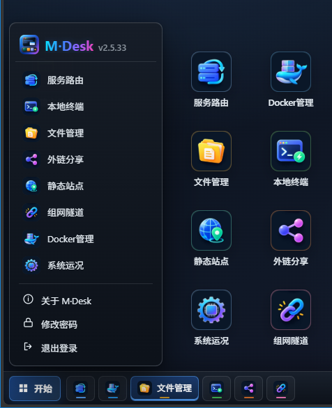
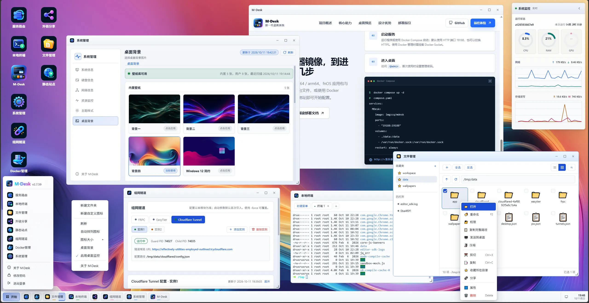
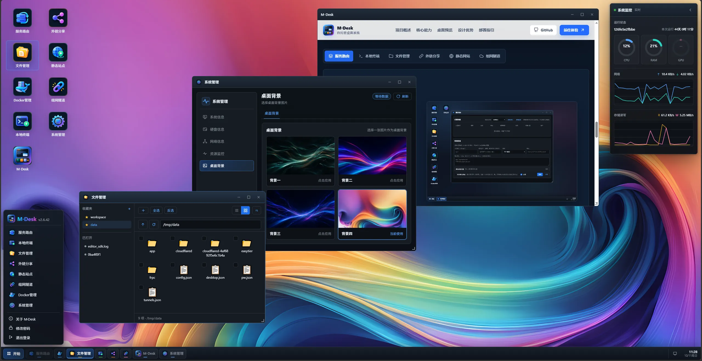
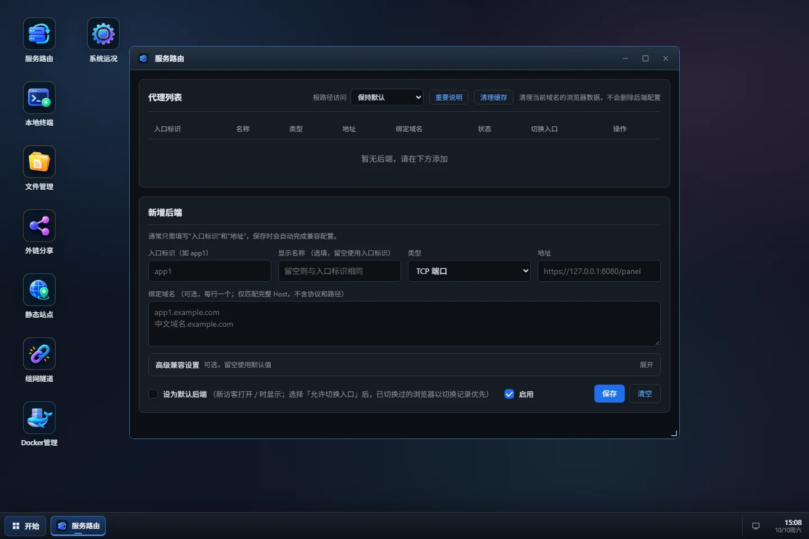
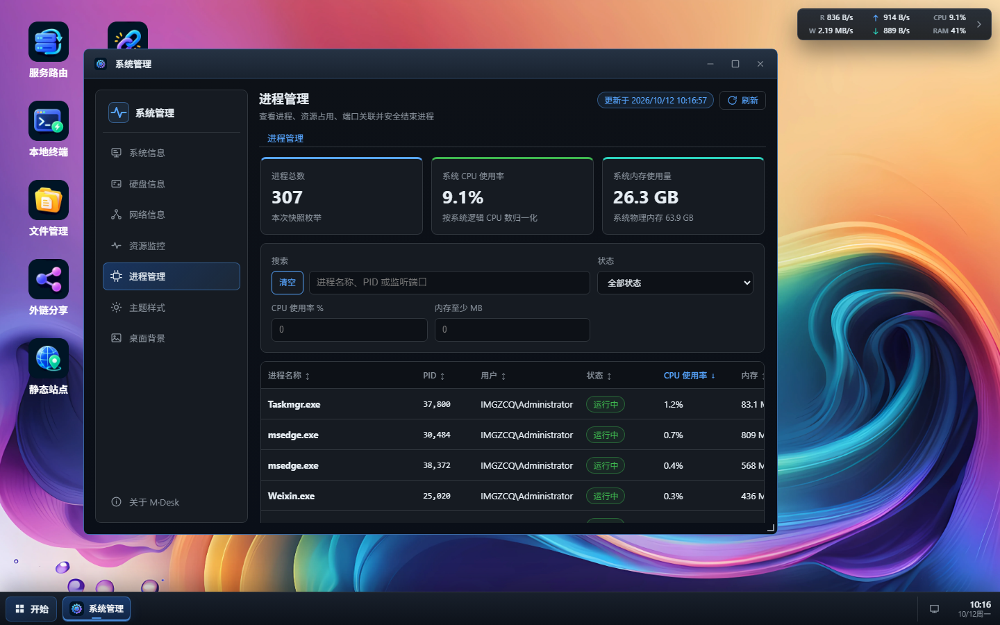

# M•Desk 使用手册

> **当前版本：** `2.8.13`
>
> M•Desk 是新一代轻量服务器的桌面管理系统；集结反代服务、本地终端、组网穿透、分享收集、静态网站、文件和 Docker 管理等服务；所有服务都基于单一端口实现，享受极致的管理体验！

> [!NOTE]
> 本手册只说明 M•Desk 的日常使用、部署与启动参数。FRPC、FRPS、EasyTier、Cloudflare Tunnel 以及其它第三方服务的配置格式，请参考对应服务的官方文档。

相关入口：[项目主页](https://github.com/IMGZCQ/MDesk) · [下载中心](https://github.com/IMGZCQ/MDesk/releases) · [官网](https://fndesk.imcq.top) · [开发文档](https://github.com/IMGZCQ/MDesk/tree/main/docs)

## 快速导航

| 章节 | 内容 |
| --- | --- |
| [1. 应用介绍](#app-intro) | 产品定位、能力范围与准备事项 |
| [2. 模块使用说明](#module-guide) | 11 个核心模块，以及多用户、个性化、远程接管与部署维护 |
| [3. 部署与启动参数](#deployment) | 通用 Linux、Docker、Windows、fnOS FPK、参数、升级回滚、运行维护与安全 |
| [4. 更新日志](#4-更新日志) | 当前版本与历史版本的主要变化 |

---

<a id="app-intro"></a>

## 1. 应用介绍

### 1.1 主要用途

M•Desk 是一套新一代轻量服务器的桌面管理系统，把常用的服务入口、运维操作与内容流转能力收束到同一张桌面里：

- 通过服务路由统一管理多个服务入口和域名绑定。
- 通过本地终端直接处理设备上的操作现场。
- 通过文件管理与分享收集承接文件流转和内容交付。
- 通过静态网站与组网隧道把服务发布到更远的地方。
- 通过 Docker、进程管理与系统状态持续观察设备运行情况。

### 1.2 功能总览

产品主体由 11 个核心模块组成，并叠加贯穿桌面的个性化、权限隔离与版本维护能力。部署方式不会改变模块的基本职责；FPK 只影响安装、配置、升级与卸载的生命周期，Windows 和部分 Linux 能力则受平台权限与系统服务实现限制。

#### 11 个核心模块

| 模块 | 说明 |
| --- | --- |
| **服务路由** | 统一管理服务入口、默认入口、域名绑定与快速切换，服务保持原有访问路径。 |
| **fnOS 应用接入** | 扫描 fnOS 应用中心，将端口、Unix Socket 与 CGI 应用接入桌面，支持应用图标、版本、访问入口与安全路径校验；代理兼容常见入口路径，并处理 Cookie、Session Token、Location、错误页与路径重写。 |
| **应用中心** | 按 M•Desk 原生应用、1Panel 源与 CasaOS 源清晰分区，安装、升级与卸载弹窗显示真实应用图标，详情分列作者和开发者；三方订阅源支持名称自动获取和地址协议自动补全，应用中心来源的桌面图标右键可打开应用信息。MPK 图标按文件内容校验并兼容常见图片格式。 |
| **本地终端** | 浏览器里的多会话终端，支持后台保活、快捷命令、收藏夹与右键菜单；快捷命令内容使用默认两行、可垂直拖拽的多行输入框；文件管理空白区右键可打开终端并自动定位当前目录。常见 POSIX 环境优先使用 Bash，同时保留 Zsh 等显式 shell 选择。 |
| **文件管理** | 浏览、编辑、上传、下载、移动、复制、压缩与解压；侧栏目录支持双击展开和收起，工具栏图标统一为 `34×34` 按钮与 `28×28` 图标。小文件支持批量上传，可一次带入嵌套目录与空文件。支持多窗口与同目录窗口复用，每个窗口独立保存路径、选择、排序和视图；复制、移动和上传冲突支持跳过、覆盖或保留两者，目录冲突递归合并，跨分区移动会先校验副本再删除源文件。编辑器支持多文件与未保存内容确认。支持右键菜单、框选、直接创建分享收集，以及图片、音视频和文本预览；列表与图标视图会按需加载图片缩略图。 |
| **分享收集** | 支持分享、收集和“都要”三种模式；收集模式仅显示上传区并支持 `1 MB` 至 `100 GB` 单文件上限，同名文件自动重命名，且只允许单个实际目录。管理员可设置上传文件后缀白名单或黑名单，默认阻止可执行文件、脚本等高风险文件直接上传。访问页面支持图片、音视频和只读文本预览，目录页可切换列表与图标视图，图标和文件名均可打开预览且间距紧凑，并可选择当前页条目打包下载。分享登录会话具有有效期，并支持主动退出。 |
| **静态网站** | 把本地目录发布为静态网站，支持默认主页、目录浏览与域名绑定；目录页支持列表与图标视图，图片、音视频和文本资源可直接预览。 |
| **组网隧道** | 支持 FRPC、FRPS、EasyTier 与 Cloudflare Tunnel，并可分别管理多个实例；FRP 服务端与客户端共用下载和校验流程，Cloudflare 提供命名隧道与快捷隧道两种模式，快捷隧道由 Cloudflare 分配临时 `*.trycloudflare.com` 地址。 |
| **Docker 管理** | 管理容器、Compose 项目、本地镜像、镜像仓库、Docker 网络与镜像加速、代理；支持按镜像、Compose 服务或容器逐项检测更新、拉取新镜像并重建服务，也支持重启 Docker 服务。容器、本地镜像与 Compose 项目列表复用全局图标解释器展示应用图标。 |
| **进程与端口管理** | 查看真实进程列表、PID、用户、状态、CPU、内存、启动时间与可执行路径；支持名称或路径搜索、精确 PID、端口反查、排序筛选、详情、复制、打开目录与安全结束进程。端口页汇总 TCP 监听与 UDP 绑定，可识别 Docker 映射，并支持复制信息、发送到桌面、打开服务或创建服务路由。 |
| **系统状态** | 查看系统与硬件信息、硬盘和 SMART 健康、网络接口与流量、CPU、内存、GPU 和资源趋势，网络总览新增公网 IP 与归属地；后台统一采样记录 CPU、内存、GPU、网络和磁盘读写趋势。系统设置支持修改设备名称，并针对不同平台提供权限、格式校验与重启提示；Linux 补充网卡链路速率读取并优化磁盘拓扑呈现，系统端口图标支持 IPv4/IPv6、HTTPS/HTTP 回退与独立缓存。 |

#### 跨模块能力

| 能力 | 说明 |
| --- | --- |
| **多用户与权限** | 管理员可在系统设置中创建普通用户，为成员配置账号状态、可用能力、多个授权目录、目录权限、存储配额和应用访问策略；普通用户的偏好、壁纸、收藏、任务、分享和终端会话相互隔离，受限功能会显示明确提示。详见 [2.12 多用户与权限](#212-多用户与权限跨模块)。 |
| **系统设置与个性化** | 提供三种尺寸密度、六种界面风格、八套应用图标套装、单击或双击打开方式，以及独立壁纸目录与批量上传。窗口布局、焦点恢复、吸附状态和后台刷新策略也会随桌面操作调整。详见 [2.13 系统设置与个性化](#213-系统设置与个性化跨模块)。 |
| **远程接管** | 从本机登录页输入另一台 M•Desk 的地址与凭据直接接管远端桌面；远端 Token 只保留在服务端内存中，断线时提供明确状态与重连入口。详见 [3.2 首次使用](#32-首次使用)。 |
| **Windows 连接管理器** | 独立 Windows 客户端，可集中保存不限数量的远程 M•Desk 与 SSH 主机，并最多同时连接 8 个；支持 PIN、自动锁定、收藏搜索、拖动排序、连接状态和资源指标。SSH 支持主机指纹确认、多终端、断线重连、SFTP 文件管理、目录收藏、快捷命令以及权限、所有者和所属组调整。详见 [3.1 部署](#connection-manager)。 |
| **版本检测、升级与回滚** | Linux 管理员可在系统状态检测更新；发布信息包含匹配架构、文件大小和 SHA-256 时，可点击“立即更新”启动独立后台任务，完成下载校验、服务重启、健康检查与版本探测，失败会自动回滚。fnOS FPK、systemd 与独立进程安装均支持该流程；Windows 维持手动下载升级，Docker 保留独立镜像更新流程。详见 [3.1 部署](#31-部署)。 |
| **数据保留与卸载策略** | 卸载默认保留用户数据；只有明确选择彻底删除时，才会清理配置、凭据、收藏、分享记录与日志。删除后无法恢复，操作前应先完成备份。详见 [3.1 部署](#31-部署)。 |

### 1.3 桌面组成







M•Desk 将侧栏、应用区与任务栏组织在同一张桌面中：

- **侧栏**：集中放置服务路由、fnOS 应用接入、本地终端、文件管理、分享收集、静态站点、组网隧道、Docker 管理、进程管理、系统状态以及账户操作。
- **应用区**：用清晰的图标入口呈现常用能力，方便快速进入对应模块。
- **任务栏**：承接应用固定、窗口切换、最小化与恢复，以及任务栏右键操作；窗口总览支持悬停、选择、双击返回与 `Escape` 退出，让当前工作位置保持可见。
- **窗口状态**：桌面会记住窗口位置、尺寸、最大化与吸附状态，重新打开后延续上次的工作布局；窗口可拖至屏幕边缘或四角分屏，拖至顶部最大化，也可从最大化状态拖拽恢复。
- **每日提示**：每个浏览器每天最多展示一次，随机呈现使用技巧；优先使用国内来源，GitHub 作为回退，并缓存到本地减少重复请求。
- **对话框**：点击遮罩不会关闭对话框，按 `Escape` 只关闭当前最上层的对话框，避免误操作丢失正在填写的内容。

### 1.4 使用前须知

- 建议使用现代浏览器访问管理入口。
- 管理入口、终端与文件管理拥有较高权限，请使用强密码并妥善保存。
- 优先通过 HTTPS、内网 ACL、VPN 或零信任网关访问，不要将管理入口直接暴露在不可信网络中。
- 组网隧道涉及第三方服务账号、Token 或配置文件，请按对应官方文档妥善保管凭据。
- fnOS 应用接入依赖运行环境对 `/var/apps` 的读取权限；权限不足时该模块会显示不可用，不影响其它功能。

---

<a id="module-guide"></a>

## 2. 模块使用说明

### 2.1 服务路由

服务路由用于统一管理多个服务入口。进入“服务路由”后，可以新增、编辑、启用、停用和删除服务，并设置默认入口。



#### 重要说明

- 服务地址支持 TCP 端口与 Unix Socket。
- 每个服务可以配置入口标识、显示名称、访问地址和域名绑定。
- 域名绑定支持每行一个域名或 IP，保存时会进行归一化与重复校验。
- 通过绑定域名访问时，根路径和子路径会优先路由到对应服务；精确 Host 优先匹配，反代服务与静态网站使用同一套域名冲突校验。

#### “默认”按钮是什么？

默认入口用于没有绑定域名、也没有明确切换目标时的兜底服务。列表中的“默认”按钮用于切换当前默认项，第一个新增的服务会自动成为默认项。

#### 高级兼容设置

服务路由会自动完成常见兼容配置。只有遇到登录异常、同名 Cookie、Token 登录或 iframe 嵌入问题时，才需要展开高级设置：

- **登录 Cookie**：多个服务使用相同 Cookie 名称时，填写各自的登录 Cookie，避免登录状态互相覆盖。
- **Token 登录**：目标服务使用 Token 而不是传统 Cookie 时配置。
- **Basic 登录适配**：上游需要用户名和密码时启用，由 M•Desk 验证后注入认证头。
- **Authorization 请求头桥接**：M•Desk 部署在会覆写 `Authorization` 的上层网关或沙箱之后时启用；页面请求的认证头会转存为 `X-MDesk-Authorization`，由代理在转发上游前还原。
- **Cookie 命名空间**：服务使用固定 Cookie 名称并发生冲突时启用。
- **清理缓存**：清理当前域名下的浏览器数据，不会删除服务配置。

### 2.2 fnOS 应用接入

当 M•Desk 运行在 fnOS 环境时，fnOS 应用接入会扫描 `/var/apps`，读取应用名称、版本、图标与访问方式，并把可用应用带进桌面。当前支持三类接入方式：

- **端口**：连接应用监听的 TCP 端口，适合常规 Web 服务。
- **Unix Socket**：连接本机 Unix Socket，适合只在本机暴露接口的应用。
- **CGI**：通过 `/cgi/...` 入口访问 CGI 应用，并保留查询参数与表单请求。

端口与 Socket 应用可通过 `/app/...` 入口访问，CGI 应用使用 `/cgi/...` 入口。CGI 接入会补齐 `TRIM_*`、应用目录、共享目录等运行环境信息，并兼容 `/cgi/ThirdParty/...` 与 `/cgi/{app}/...` 入口。代理会处理 Cookie、Session Token、Location、错误页与路径重写，同时修复快速输出截断和重定向问题，让应用在桌面内保持原有访问路径。

接入过程会校验路径穿越、符号链接逃逸与应用边界，避免应用越权访问其它目录。应用可以绑定到桌面图标或快捷方式，方便从工作区直接进入。

如果运行环境无法读取 `/var/apps`，fnOS 应用接入会显示为不可用，但不会影响服务路由、终端、文件管理或其它模块。

### 2.3 应用中心

应用中心用于安装、管理和更新 M•Desk 应用，并与桌面图标保持同步。应用来源按「M•Desk 原生应用」「1Panel 源」「CasaOS 源」分区，查找和安装时不会把原生应用与三方 Compose 应用混在一起。

- **本地与在线安装**：支持拖入单个 `.mpk` 安装包，也支持从已添加的应用源在线安装；安装、配置、启动和失败清理分开处理，避免未完成的安装提前写入正式配置。
- **升级与卸载**：已安装应用可直接检查更新、升级或卸载，操作弹窗显示应用真实图标，并列出作者、开发者、版本和来源信息。
- **三方应用源**：订阅源支持自动获取名称和补全地址协议；1Panel 与 CasaOS 的 Compose 兼容应用按各自规则校验，不套用 MPK 的一次性安装票据。
- **图标与桌面入口**：应用安装、升级、卸载和停止后会同步桌面状态；从应用中心来源打开的桌面图标可查看应用信息，容器与已安装应用也会复用统一图标解释器显示真实图标。
- **成员权限**：管理员可区分应用启动权限与管理权限，并按成员和单个应用配置可用范围；普通成员只会看到已授权应用。
- **应用源发布**：三方应用源可生成独立静态商店页，提供响应式布局、主题切换、应用详情、应用源地址复制与安装包下载。

MPK 安装包会校验清单、架构、版本和图标文件内容，并兼容 PNG、JPEG、WebP、GIF、AVIF、BMP、ICO、HEIC/HEIF、TIFF、JPEG XL 与 SVG 等常见图片格式。安装包解析失败、版本不兼容或图标不可用时，界面会给出具体错误，不会把损坏文件当作有效图标加载。

### 2.4 本地终端

本地终端提供浏览器中的多会话终端：

- 支持创建多个会话并在标签之间切换。
- 会话可以在后台保活，重新打开页面后继续使用。
- 在文件管理空白区右键选择“打开终端”后，会新建或激活终端并执行 `cd` 定位到当前目录。
- 新增或编辑快捷命令时，命令内容使用默认两行、可垂直拖拽的多行输入框，适合保存多行脚本。
- 右键菜单提供复制、粘贴、清屏、收藏夹、快捷命令、最大化和关闭会话。
- 支持常用命令收藏，减少重复输入。
- Linux 等环境未指定 shell 或使用 `sh`、`dash`、`ash` 等基础 POSIX shell 时，会优先使用可用的 Bash，获得更完整的提示符与交互能力；用户明确指定 `zsh` 等 shell 时保持原选择。

终端拥有较高权限，请避免在共享浏览器中保存敏感命令或凭据。

### 2.5 文件管理

文件管理用于浏览和操作设备上的文件：

- 右键菜单会显示常用操作快捷键；选中文件后可按 `F2` 重命名、`Ctrl+C` 复制、`Ctrl+X` 剪切、`Ctrl+V` 粘贴、`Delete` 删除。
- 支持同时打开多个文件窗口管理不同目录；重复打开同一目录时会复用已有窗口，每个窗口独立保留当前路径、选择、排序和视图状态。
- 文件操作完成后只刷新受影响窗口，按 `F5` 刷新当前激活窗口。
- 支持目录浏览、文件编辑、上传、下载、重命名、移动、复制、压缩和解压。
- 小文件支持批量上传，嵌套目录与空文件可一次带入；遇到同名冲突时仍可选择跳过、覆盖或保留两者。
- 复制或移动同名内容时，目录与同名目录会递归合并；同名文件会以安全方式覆盖，并处理同级目录与文件之间的类型冲突。
- 文件编辑器支持多文件独立编辑和同路径窗口复用；关闭未保存文件时，可以取消关闭、不保存直接关闭或保存后关闭，保存后只刷新相关文件。
- 上传、下载、复制与移动任务会进入统一后台任务中心，集中显示进度、状态、类型与历史记录；可取消、删除或清理已完成任务，离开当前页面后仍可继续跟踪。
- 文件列表支持按表头排序，并记忆当前目录的排序偏好；收藏夹保存流程更加稳定。
- 图片预览支持左右滑动或相册前后切换、循环浏览、计数和工具栏；可双击、滚轮或触控捏合缩放，拖动平移，并用键盘切换、缩放和关闭。相邻图片会预加载，HEIC 图片在浏览器不支持时自动转换，加载失败会显示明确提示。
- 列表与图标视图先显示默认图标，图片进入可视区后再加载缩略图；打开图片时先显示缩略图，再加载原图，原图显示后会移除缩略图层，缩略图失败会自动回退。
- 视频预览支持单击播放或暂停、双击切换全屏、长按临时 `2x` 播放、横向拖动快进快退；左侧上下拖动调节亮度，右侧上下拖动调节音量，普通与全屏模式保持一致。播放器控制栏会根据操作状态自动显示或收起。
- 支持右键菜单、框选和全选，方便批量整理文件。
- 侧栏通过“目录 / 收藏 / 已打开”标签切换，目录支持双击展开和收起；路径栏与工具栏图标采用统一的 `34×34` 按钮和 `28×28` 图标规格。
- 选中文件或目录后，可以直接创建分享链接。
- 支持收藏常用目录，减少重复定位。
- 图片、音频、视频和文本可以直接预览；音频播放器提供封面、歌曲信息、播放列表、歌词、搜索、随机与循环播放，文本以只读方式查看。
- 符号链接和 Windows junction 会被识别并标记为目录链接、文件链接或失效链接，方便判断项目真实状态。

### 2.6 分享收集

分享收集可以为文件或目录创建公开链接，也可以作为访客上传入口：

- 支持三种模式：“分享”只开放浏览与下载，“收集”只显示上传区，“都要”同时开放浏览、下载与上传。
- 收集与“都要”模式可设置 `1 MB` 至 `100 GB` 单文件上限；超限文件会在选择后、上传前明确提示大小与上限，并可直接移除。
- 访客上传同名文件时会自动重命名；只有单个实际目录可以启用收集，多路径或普通文件会自动限制为纯分享。
- 管理员可配置上传文件后缀策略：白名单只允许列出的后缀，黑名单禁止列出的后缀；默认策略会阻止可执行文件、脚本等高风险文件直接上传。
- 公开目录页支持列表与图标视图，可全选或取消当前页选择；有选择时按钮变为“打包下载选中”，无选择时继续整包下载。
- 图标视图中的图标和文件名都调用同一套预览入口，两者之间不再保留整行空白。
- 纯收集页不显示已有目录内容，也不提供文件下载入口。
- 支持设置分享名称和分享描述。
- 支持设置访问密码。
- 分享管理列表直接显示分享地址；编辑带密码的分享时，可以查看已保存的访问密码。
- 需要密码的分享在验证成功后会建立有时效的登录会话；点击“退出登录”、修改分享密码、关闭分享或安全设置变化后，当前会话立即失效。
- 新建分享默认启用到期时间并预填 7 天，也可快速选择 1 天、3 天、7 天、1 个月或自定义时间。
- 支持随时暂停、恢复或删除分享。
- 分享不存在、已停用、已到期或路径异常时会显示对应提示页，并返回明确的状态码；这类页面不会被浏览器缓存。
- 可以从文件管理中直接选中文件或目录创建分享。
- 图片、音视频可在访问页面直接预览；图片支持按序号定位并继续浏览当前相册，视频使用与桌面端一致的触控手势。文本内容以只读方式查看，所有预览继续受分享密码、有效期和目录边界保护。
- 分享目录、收集页和单文件分享均可使用音频播放器，并支持 LRC、同名 TXT 与音频内嵌歌词；音频和歌词请求继续受分享密码、有效期和目录边界保护。

创建完成后，复制分享链接即可交付给访问者。需要控制访问范围时，建议同时启用访问密码和到期时间。

### 2.7 静态网站

静态网站用于把本地目录发布为网站：

- 选择一个本地目录作为网站根目录。
- 支持配置多个默认主页。
- 支持选择是否允许目录浏览。
- 站点根目录可放置 `404.html` 作为自定义缺失页面；未配置时显示统一 404。未开启目录浏览的目录会返回 403，不会暴露目录列表。
- 支持绑定域名。
- 目录浏览支持列表与图标视图切换。
- 站点中的图片、音视频和文本资源可直接预览，访问路径仍受目录边界保护。
- 静态网站中的音频可使用单列播放器直接播放，展开播放列表、歌词、搜索、随机与循环控制。

域名填写规则与服务路由一致：每行一个域名或 IP，不包含协议、端口、路径和通配符，并确保 DNS 已解析到 M•Desk。

### 2.8 组网隧道

“组网隧道”用于把本地服务安全地带到外网。当前支持 FRPC、FRPS、EasyTier 与 Cloudflare Tunnel。

#### 基本操作

1. 选择 FRPC、FRPS、EasyTier 或 Cloudflare Tunnel。
2. 填写对应服务需要的地址、端口、Token、配置文件或 Tunnel ID。
3. 保存并应用配置。
4. 使用状态切换按钮启动或停止隧道。
5. 在运行日志中查看连接状态和错误信息。

日志页面会自动更新。页面停留在底部时会跟随最新内容；向上滚动查看历史时会暂停跟随，回到最底部后恢复。

#### Cloudflare Tunnel

Cloudflare Tunnel 支持两种使用方式：

- **命名隧道**：适合长期使用，填写 Tunnel Token 或配置文件后保存并应用。
- **临时隧道**：适合临时验证，只需要填写本地服务地址即可启动，由 Cloudflare 分配临时 `*.trycloudflare.com` 公开地址。

两种模式通过单选方式切换。临时隧道适合临时预览或调试，地址和生命周期由 Cloudflare 管理；需要固定入口时，建议使用命名隧道。

#### 配置来源

- 页面中保存的配置优先于启动参数。
- 使用 `-cf-token` 可以首次导入 Cloudflare 命名隧道 Token。
- 使用 `-frpc-config`、`-frps-config` 和 `-easytier-config` 可以首次导入 FRPC、FRPS、EasyTier 配置文件，参数支持本地路径或 HTTP(S) URL。
- 远程配置发生变化后，可以使用 `-force` 重新导入，或直接在模块中更新。

### 2.9 Docker 管理

Docker 管理用于在桌面中查看和维护宿主机 Docker 环境。模块默认通过 `/var/run/docker.sock` 连接 Docker，也支持使用 `DOCKER_SOCKET` 或 `DOCKER_HOST=unix://...` 指定其他 Unix Socket；当前不支持通过 `DOCKER_HOST` 使用 TCP 连接。

#### 可用页面

- **概览**：查看容器、Compose 项目、本地镜像和资源占用摘要，并可以重启 Docker 服务。
- **容器**：搜索、添加、启动、停止、重启、删除容器，查看 CPU、内存、网络、日志，并可直接打开容器终端。
- **Compose 项目**：识别 Compose 项目，支持启动、停止、重启、删除项目，以及新增、编辑和保存 Compose YAML。
- **本地镜像**：搜索、拉取、删除本地镜像，并查看镜像大小、创建时间和使用状态；支持检测镜像更新并拉取新镜像。
- **镜像仓库**：搜索镜像仓库，查看来源并拉取镜像到本地。
- **网络**：查看 Docker 网络、驱动、关联容器和属性，支持创建、删除网络。

更新检测按镜像、Compose 服务或容器逐项触发。检测到可用更新后，可以直接拉取新镜像，并按需要重建对应容器或 Compose 服务。

#### 应用图标

容器、本地镜像和 Compose 项目三张列表都会展示应用图标。图标不是 Docker 自带的图形，而是复用 M•Desk 现有的**图标解释器**解析得到的结果，解析规则、缓存策略与「端口管理卡片」完全一致：

- 容器按已发布的 TCP 端口探测本机服务的网页图标，探测失败再按镜像名或容器名匹配已安装应用（MPK / fnOS）的图标。
- 本地镜像没有运行中的端口，直接按镜像引用匹配已安装应用图标。
- Compose 项目优先使用项目内容器已发布的端口，其次使用项目容器名或镜像引用匹配。
- 镜像自带的 `org.opencontainers.image.url` / `org.opencontainers.image.documentation` 标签会作为最后的兜底来源。

解析成功即显示对应图标；解析失败或没有匹配图标时显示统一占位图标，与端口管理卡片、自定义图标的兜底表现一致。图标解析在后台批量进行，列表较多时会有短暂加载指示，不会阻塞列表滚动。

图标缓存完全沿用图标解释器自身的机制：解析结果落在服务端图标缓存里（成功保留 7 天、失败冷却 2 分钟），前端只做「本页已有结果不重复请求」的去重，不跨会话另存。批量解析有总时长上限，条目很多时到点即返回，没解析完的显示占位图标而不是一直转圈。

图标格式支持 PNG、JPEG、WebP、ICO 与 SVG。SVG 会在保存前做安全清洗：脚本、事件属性、`style` 属性、外部引用一律剔除，但文档内的 `url(#id)` 引用（渐变、遮罩、裁剪等最常见的 SVG 写法）会正常保留，因此使用渐变图标的站点也能取到图标。

#### 镜像加速与代理

进入“镜像仓库”后，可以通过“加速与代理”配置 Docker 镜像加速器和 HTTP / HTTPS 代理。代理配置会写入宿主机 Docker daemon 配置文件中的 `proxies` 字段，通常为 `/etc/docker/daemon.json`：

```json
{
  "proxies": {
    "http-proxy": "http://127.0.0.1:7890",
    "https-proxy": "http://127.0.0.1:7890",
    "no-proxy": "localhost,127.0.0.1,.internal"
  }
}
```

保存后，Docker 镜像拉取和 Compose 更新需要重启 Docker 服务才能使用新代理；MDesk 的镜像更新检测和仓库搜索会立即读取新配置。`no-proxy` 支持逗号分隔的域名、IP、CIDR 和通配符域名。

#### 权限与环境要求

- 建议在 Docker 所在 Linux 宿主机上运行 M•Desk。
- 运行 M•Desk 的用户需要拥有 Docker Socket 的读写权限。
- 读取或写入 `/etc/docker/daemon.json`、重启 Docker 服务时，需要对应的宿主机权限。
- 删除容器、镜像或网络属于不可恢复操作，执行前请确认影响范围。

### 2.10 进程与端口管理

进程管理用于定位设备上的真实进程、资源占用和端口关联，适合排查高占用、端口冲突和异常服务。



- 进程列表呈现 PID、名称、用户、状态、CPU、内存、启动时间与可执行路径。
- 支持按名称或路径搜索，也可以输入精确 PID 定位指定进程。
- 支持从端口反查占用进程，并按 CPU、内存等字段排序和组合筛选。
- 右键菜单可以查看进程详情、复制信息、打开可执行文件所在目录、查询端口或结束进程。
- 进程、服务与端口长列表可在空白区域按住拖动滚动，同时保留按钮、下拉选择与右键菜单操作。
- 结束进程前会校验进程身份，并保护 M•Desk 自身、自身可执行文件、PID 不大于 4 的进程以及关键系统进程。
- Linux 使用 `SIGTERM` 请求进程正常退出；当前 Windows 普通结束进程入口尚未开放，页面会明确提示不可用。

进程数据来自当前设备的实时快照，部分资源指标取决于系统权限和平台能力，无法读取时会明确显示为不可用。

#### 端口管理

端口管理用于查看当前设备真实的监听面，属于只读诊断工具，不会直接修改 M•Desk 的监听端口或反向代理规则：

- 汇总 TCP 监听与 UDP 绑定，展示协议、监听地址、端口、归属进程与运行身份。
- 识别 Docker 容器和宿主机端口映射，并在可识别时显示服务名称与应用图标。
- 右键菜单可按条目能力查看详情、复制信息、发送到桌面、打开服务或创建服务路由。
- “创建路由”只会新增一条可编辑的服务路由，不会擅自改动已经占用的端口或中断目标进程。

如果需要修改 M•Desk 自身监听的协议与端口，Linux、Docker 和 Windows 应调整启动参数；fnOS FPK 应通过应用配置修改访问协议与端口。端口管理页面展示的是系统现状，不是 M•Desk 的运行时配置入口。

### 2.11 系统状态

系统状态用于集中查看设备运行情况，数据由宿主机接口和系统命令采集。页面不会用 `0` 代替不可用指标，无法读取的字段会明确显示为暂不支持或不可用。

#### 系统服务

- 集中查看 systemd 与 Windows 服务的运行状态和启动类型。
- 支持按名称搜索、按状态筛选、按字段排序并查看服务详情。
- 可以启动、停止、重启服务，并调整开机启动；并发操作、权限限制和平台不支持项会给出明确反馈。
- 服务与进程、端口长列表均可在空白区域按住拖动滚动，减少大量条目下的滚动条操作。
- 服务列表实时刷新时会保持当前拖动与滚动位置，避免列表更新后跳动。

#### 系统信息

- **总览**：查看设备型号、系统版本、内核、架构、启动时间、运行时长、CPU、内存与当前版本。
- **系统与硬件**：查看 CPU、内存、GPU、主板、BIOS / 固件与系统温度。
- **软件与版本**：查看系统名称、内核、构建版本、软件更新状态、启动时间和运行时长。

#### 软件更新

- 打开系统状态时，界面会通过同源 `/api/system/update` 获取当前版本、最新版本与更新说明。
- 可以手动点击“检测更新”或“重新检测”，比较当前版本与最新版本。
- 发现新版本后，可从更新内容对话框前往下载中心查看完整发布信息。
- Linux 管理员确认升级后，更新任务会先下载当前架构对应的程序包，并校验文件大小与 SHA-256；校验全部通过后才会停止当前实例、替换程序并重启。
- 更新任务在独立后台进程中运行，关闭浏览器、终端或 SSH 连接不会中断；后台心跳用于识别意外中断，任务中断后可重新发起更新。
- 新版本启动后必须通过健康检查与版本探测；失败时自动恢复原程序及运行环境。fnOS FPK 会同时修复应用实例 PID。
- Windows 当前仍为手动下载新版 `.exe` 后替换，不提供程序内自动更新；Docker 继续保持独立的镜像拉取与容器重建流程。
- 更新信息由 M•Desk 服务端查询官网版本元数据后返回，浏览器不直接访问 GitHub Releases；查询失败时只显示检测失败，不影响其它模块使用。
- Linux 一键安装仍保留 `sudo mdeskctl update` 命令行入口；fnOS App Center 的 FPK 升级和 Docker 镜像更新也继续可用，详见 [3.1 部署](#deployment)。

#### 硬盘信息

- **硬盘总览**：查看物理硬盘、文件系统、容量、使用率、温度、健康状态和实时读写速度。
- **内置硬盘**：查看系统识别为内置的物理硬盘与分区信息。
- **外置硬盘**：查看系统明确识别为外置的存储设备。
- **健康与 SMART**：查看 SMART 可用状态、通电时间、通电次数、重分配扇区、待处理扇区、不可纠正错误和温度。

硬盘数据采用并行采集与短期缓存复用，文件系统、物理硬盘和磁盘计数器可以同步加载；Linux 端支持 `holders` / `slaves` 逻辑设备关系与 Btrfs 成员设备，并优化 dm、RAID、分区到挂载点的映射与磁盘拓扑呈现。Windows 端会优先读取原生信息，并在需要时使用 UTF-8 输出与临时文件回退，减少中文乱码和信息缺失。

SMART 数据只作为设备健康参考，不会自动修复硬盘，也不会执行销毁数据的操作。

#### 网络信息

- **网络总览**：查看连接状态、活动接口、IPv4、IPv6、网关、DNS 和链路速率。
- **公网信息**：查看公网 IP 与归属地；查询失败时会说明原因，并自动尝试备用服务。
- **网络接口**：查看接口类型、状态、MAC、地址、CIDR、网关、DNS、链路速率和收发统计。
- **流量监控**：切换接口查看实时接收、发送速率和历史趋势。

#### 资源监控

- **总览**：集中查看 CPU、内存、网络、硬盘和 GPU 的实时状态。
- **CPU**：查看总体使用率、用户态、系统态、负载、每核心使用率、频率和温度。
- **内存**：查看已用、可用、空闲、缓存和 Swap 使用情况。
- **Swap 管理**：Linux 环境可查看 Swap 路径、类型、容量与使用率，调节虚拟内存使用倾向，并安全启停或调整单个 Swap 文件容量；分区或多重 Swap 配置会采用更稳妥的启停策略。
- **网络**：查看接口速率、累计流量和实时趋势。
- **GPU**：查看设备状态、显存、使用率和历史趋势。

资源趋势支持 `1 分钟`、`5 分钟`、`15 分钟` 和 `1 小时` 时间范围。系统监控由后台统一采样，集中记录 CPU、内存、GPU、网络和磁盘读写趋势，打开监控面板即可查看连续数据，减少重复采集。

<a id="212-多用户与权限跨模块"></a>

### 2.12 多用户与权限（跨模块）

管理员可以在系统设置的“管理用户与权限”中维护成员。成员不是独立的 M•Desk 实例，而是在同一套服务端能力上获得经过授权的独立工作空间。

#### 成员配置

- 设置账号状态、可用能力与系统信息可见范围。
- 授权一个或多个目录，并分别为每个目录设置读取、写入、管理等权限。
- 设置存储配额，限制成员可占用的文件空间。
- 按成员和单个应用配置应用启动与管理权限。
- 偏好、壁纸、收藏、任务、分享、终端会话、文件传输与任务队列按用户隔离。

#### 日常操作

- 新增或编辑成员后，应按其实际工作范围配置目录与能力，不要直接复用管理员账号。
- 重置成员密码会立即使该成员现有的活动会话失效，需要使用新密码重新登录。
- 删除成员或撤销目录授权只会移除 M•Desk 中的访问关系和控制记录，不会删除磁盘上的业务文件。
- 普通成员只能看到已授权的功能和设置项；遇到未授权能力时，界面会给出明确提示。

<a id="213-系统设置与个性化跨模块"></a>

### 2.13 系统设置与个性化（跨模块）

- “界面外观”提供经典、紧凑、宽松三种尺寸密度，以及经典、Win11、macOS、霓虹、终端控制台、纸面工作台六种界面风格；选择即时生效并自动保存，默认使用经典密度与 Win11 风格。
- 系统设置提供八套应用图标套装，包含 V8“极简风格”，可随时切换桌面视觉风格。
- 桌面图标支持选择单击或双击打开，适配不同设备和操作习惯。
- 用户壁纸支持指定独立目录，也可以在壁纸设置中拖放或批量上传 JPG、PNG、GIF、WebP 图片；系统会校验图片并立即刷新壁纸列表，独立目录的变化仍会自动检测。
- 桌面监控小组件采用更紧凑的展示样式。
- 应用中心按「M•Desk 原生应用」「1Panel 源」与「CasaOS 源」分区；安装或卸载应用时会自动同步桌面图标。
- 窗口焦点恢复、任务栏显示以及任务中心和隧道页面的后台刷新策略会根据页面可见状态自动调整。
- 外部链接无法在应用内打开时，会显示明确提示，并提供重试与在浏览器中打开的入口。

---

<a id="deployment"></a>

## 3. 部署与启动参数

### 3.1 部署

M•Desk 的主要运行目标是 Linux，常见服务器发行版、NAS 与自托管环境都可以使用一键安装或独立二进制。Docker、Windows 与 fnOS FPK 是并列的部署选项；FPK 是飞牛 fnOS 的平台专用安装包，不代表 M•Desk 只能运行在 fnOS。

| 环境 | 推荐方式 | 适用场景 | 首次设置密码 |
| --- | --- | --- | --- |
| 常见 Linux 服务器 / NAS | 一键安装 | 自动识别架构、注册服务、配置开机启动 | 首次打开管理入口 |
| 需要自行控制运行方式 | Linux 独立二进制 | 自定义 systemd、OpenRC、进程守护或数据目录 | 首次打开管理入口 |
| 已有 Docker / Compose | Docker Compose | 容器化升级、挂载与数据卷管理 | 首次打开管理入口 |
| Windows | 服务版 / 桌面版 | 长期后台服务或桌面窗口使用 | 首次打开管理入口 |
| 飞牛 fnOS | FPK | 应用中心安装、配置、升级与桌面入口同步 | FPK 安装向导中设置 |

所有部署方式使用相同的管理能力。差异主要来自服务管理、数据路径、权限边界和升级方法。

#### 通用 Linux：一键安装（推荐）

脚本会自动识别 `amd64`、`arm64` 或 `armv7`，优先从项目镜像下载对应二进制；镜像不可用时回退到 GitHub Release 加速线路。安装时优先使用 systemd，并兼容 OpenRC、SysV；所选服务管理器注册、启动或健康检查失败时，会自动降级为独立后台进程。后台模式会在 cron 可用时注册开机启动。

```bash
curl -fsSL https://raw.githubusercontent.com/IMGZCQ/MDesk/main/install.sh | sudo bash
```

脚本会询问服务端口与安装目录，默认分别为 `19188` 和 `/opt/MDesk`。已安装时再次运行会显示管理菜单，可选择重新安装/升级、卸载或取消。也可以使用：

```bash
sudo bash install.sh install
sudo bash install.sh update
sudo bash install.sh uninstall
```

安装完成后会按当前环境注册并启动服务。默认管理地址为：

```text
http://<设备地址>:<端口>/@admin
```

首次打开管理入口时设置管理员密码。密码长度为 `8–128` 个字符，并且必须同时包含字母和数字。Linux 一键安装本身不要求预先填写管理员密码。

升级或重新安装会交给独立后台任务执行，即使 MDesk 内置终端、SSH 会话或发起命令的终端断开，更新仍会继续。任务会下载并校验新二进制、重启服务并执行 HTTP 健康检查；失败时会恢复旧二进制和配置，如果原服务管理器仍无法启动，则会自动用后台进程恢复旧版本。

```bash
sudo mdeskctl update
sudo mdeskctl status
```

更新日志和最近状态分别保存在 `/etc/mdesk/update.log` 与 `/etc/mdesk/update.status`。系统同时没有服务管理器和 cron 时，后台进程仍可使用，但系统重启后需要执行 `sudo mdeskctl start`。

卸载默认保留用户数据；只有在卸载向导中明确选择删除数据时，才会清理安装目录中的数据。删除后无法从 M•Desk 恢复，请在操作前自行备份。

#### 通用 Linux：独立二进制

从 Releases 下载匹配架构的 `MDesk-linux-amd64`、`MDesk-linux-arm64` 或 `MDesk-linux-armv7`，放到可写目录后运行：

```bash
chmod +x ./MDesk-linux-amd64
./MDesk-linux-amd64
```

默认监听 HTTP `19188` 端口，访问地址为：

```text
http://<设备地址>:19188/@admin
```

首次打开管理入口时设置管理员密码。ARM64 与 ARMv7 设备请替换为对应文件名。独立二进制适合自行编写 systemd、OpenRC、进程守护或容器编排配置；长期运行时，应由系统服务管理器负责开机启动、日志和异常重启。

#### Docker Compose 部署

创建 `compose.yaml`：

```yaml
services:
  MDesk:
    container_name: MDesk
    image: imgzcq/mdesk
    network_mode: host                              # 网络类型
    restart: always                                 # 自动启动
    command: ["-port", "19188"]                     # 自定义端口
    volumes:
      - /var/run/docker.sock:/var/run/docker.sock   # Docker管理
      - ./data:/usr/local/bin/data                  # 应用数据持久化
      #- /var/apps:/var/apps                        # 接入飞牛应用
      #- /vol1:/vol1                                # 接入飞牛应用
```

> 提示：飞牛应用相关挂载默认注释，非飞牛系统保持注释即可。在 fnOS 中使用应用接入时，取消这两行注释，并将 `/vol1` 调整为应用实际所在的存储卷；存在多个存储卷时分别挂载对应的 `/volX`。

> 提示：`command` 会覆盖镜像默认的 `-data /data` 参数，程序因此使用可执行文件所在目录下的 `data`，即 `/usr/local/bin/data`。请保持 `volumes` 挂载路径为 `./data:/usr/local/bin/data`，确保配置、账号与图标等数据持久化。

在 `compose.yaml` 所在目录执行：

```bash
docker compose up -d
```

`/var/run/docker.sock` 用于 M•Desk 的 Docker 管理功能。不需要该功能时可以移除这一行，但容器、Compose、镜像与网络页面将无法连接宿主机 Docker。

> [!CAUTION]
> 挂载 Docker Socket 后，M•Desk 将拥有较高的宿主机控制权限。请只运行可信镜像，限制管理入口的访问范围，并妥善保护管理密码与访问链路。

#### Windows

- `MDesk-Windows-服务版.exe` 在后台提供管理服务，适合长期运行。
- `MDesk-Windows-桌面版.exe` 以桌面窗口承载管理界面，适合桌面使用。
- 首次打开管理入口时设置管理员密码。
- 系统服务、进程、Swap 和部分硬件能力受 Windows 平台实现与当前用户权限限制，页面会明确显示不可用项。

<a id="connection-manager"></a>

#### Windows 连接管理器

`MDesk管理器.exe` 是独立的 Windows 远程管理客户端，不提供 M•Desk 服务端，也不属于第六种部署方式。它用于从 Windows 10/11 x64 电脑集中访问多台已经部署好的 M•Desk。

首次启动时创建本机 PIN。进入管理器后可新增远程 M•Desk 地址与账号信息；保存数量不限，最多同时打开 8 个远程会话。列表支持收藏、搜索、拖动排序、地址隐藏和连接状态检测，并可显示延迟、CPU、内存与存储等资源概况。

连接管理器支持保存、搜索和收藏 SSH 主机，也可以同时打开多个交互终端。首次连接需要确认 SHA-256 主机指纹，之后指纹变化会阻止连接；终端会话关闭或断线时会显示明确状态，并可直接重新连接。

SSH 文件侧栏支持上传下载、目录浏览、新建、重命名、复制、移动和删除远程文件，支持远程目录收藏、快捷命令和终端右键操作。也可以修改文件权限、所有者与所属组，并将变更递归应用到目录内容。

安全与运行说明：

- 本机 PIN 用于保护管理器操作和自动锁定，但不会加密地址、名称或偏好配置文件。
- 远程密码可选择保存，保存时由当前 Windows 用户的 Credential Manager 保护。
- HTTPS 会正常验证证书；自签名证书只有在确认 SPKI SHA-256 指纹后才应加入信任。
- 每个远程目标使用独立的 Cookie 与 Web Storage，会话之间不会共享登录状态。
- Bearer Token 只保留在管理器进程内存中，不写入配置文件或前端 JavaScript。
- 管理器只监听 `127.0.0.1`，关闭主窗口后可继续驻留系统托盘。
- 程序使用 Microsoft Edge WebView2 Evergreen Runtime；缺少 Runtime 时会显示明确错误。

#### fnOS FPK（平台专用）

FPK 面向飞牛 fnOS，安装包内含 amd64 与 arm64 二进制。它和通用 Linux 安装的主要区别在安装向导、应用中心生命周期与飞牛桌面入口同步。

1. 从 Releases 下载 `MDesk_2.8.13.fpk`。
2. 在 fnOS 应用中心选择本地安装并上传 FPK。
3. 在安装向导中设置访问端口、HTTP / HTTPS、管理员密码与密码确认。
4. 安装完成后，从 fnOS 桌面或按所选协议与端口打开管理入口。

FPK 默认使用 HTTP `19188`。管理员密码长度为 `8–128` 个字符，并且必须同时包含字母和数字。由于密码在安装向导中建立，FPK 安装完成后不会再次出现普通 Linux 部署的首次设密页面。

- **修改配置**：应用配置可修改访问协议与端口，但不负责修改管理员密码。
- **重新安装**：即使保留旧数据，重新安装也会重新设置管理员密码。
- **应用中心升级**：按 FPK 生命周期升级并保留现有数据。
- **数据位置**：应用数据使用共享 `data` 目录，服务日志写入 `运行日志.log` 并按大小轮转。
- **卸载**：默认保留数据；只有明确选择彻底删除时，才会移除应用私有数据、共享 `data`、`运行日志.log` 及轮转日志。配置、凭据、收藏、分享记录和日志会随数据一起删除，操作不可恢复。

FPK 用户同样可以使用服务路由、终端、文件管理、分享收集、静态网站、组网隧道、Docker、进程管理、多用户与系统状态；fnOS 应用接入是额外的平台能力。

#### 管理入口与健康检查

如果将管理入口改为自定义路径，默认 `/@admin` 会释放为普通路径：绑定 Host 时按原路径反代或访问静态站点，否则进入默认代理链。旧路径不再执行登录、会话或管理页面逻辑，也不再附加管理专用 CSP、X-Frame-Options 或 no-store 响应头；`/@mdesk` 和 `/@app` 不可设置为管理入口。自定义路径继续作为唯一管理入口。

服务健康检查固定使用 `GET/HEAD /@mdesk/healthz`，与管理入口路径无关；Linux 一键安装脚本的启动探测也使用该端点。

如果后端尚未配置或暂时不可用，浏览器访问管理入口时会看到明确的状态提示页；接口请求仍返回 JSON 错误，便于脚本或集成端识别问题。

### 3.2 首次使用

#### 本机登录

1. 打开管理入口；Linux、Docker 与 Windows 首次访问时设置管理密码，FPK 使用安装向导中已经设置的密码。
2. 输入管理员用户名与密码登录。密码长度为 `8–128` 个字符，并且必须同时包含字母和数字。
3. 进入桌面后按需配置服务路由、终端、文件管理、分享、静态网站、组网隧道、Docker、进程管理、成员权限与系统状态。

登录默认在 30 分钟无操作后自动登出，也可以选择保持登录 12 小时、24 小时、3 天、5 天或 7 天。主动退出或修改密码后，旧会话会立即失效。

#### 远程接管登录

本机登录页也可以输入另一台 M•Desk 服务器的地址与凭据，直接接管远端桌面：

- 远端密码用于换取远程访问 Token；Token 只保留在服务端内存中，不写入浏览器存储或磁盘。
- 远程接管不会在远端服务器上创建一个普通的本机管理会话。
- 桌面显示可拖动的接管状态栏，并提供断开与重新连接入口。
- 临时网络中断可能在后台透明重连；远端 Token 过期或远端进程重启后，界面会重新要求输入凭据。
- 可以随时退出远程接管并返回本机登录流程。

远程接管仍然使用远端服务器已有的账号、权限和数据边界。跨公网使用时，建议先通过 VPN、Zero Trust 或受控反向代理建立可信链路。

### 3.3 启动参数

| 参数 | 说明 |
| --- | --- |
| `-scheme` | 设置 HTTP 或 HTTPS，默认 `http` |
| `-addr` | 设置完整监听地址，例如 `127.0.0.1:8080` 或 `:8080`；与 `-port` 二选一，`-addr` 优先 |
| `-port` | 设置监听端口，默认 `19188`；`-addr` 为空时生效 |
| `-data` | 设置数据目录，默认使用程序所在目录下的 `data` |
| `-log` | 设置运行日志文件；日志文件按 5MB 轮转并保留 3 份，留空则写入标准错误 |
| `-reset-password` | 重置管理密码后退出程序；新密码需要满足密码强度要求 |
| `-frpc-config` | 首次导入 FRPC 配置文件；支持本地路径或 HTTP(S) URL |
| `-frps-config` | 首次导入 FRPS 配置文件；支持本地路径或 HTTP(S) URL |
| `-easytier-config` | 首次导入 EasyTier 配置文件；支持本地路径或 HTTP(S) URL |
| `-cf-token` | 首次导入 Cloudflare 命名隧道 Token |
| `-force` | 强制使用命令行中的组网隧道配置覆盖已有模块配置 |

### 3.4 可选环境变量

| 环境变量 | 说明 |
| --- | --- |
| `MDESK_GITHUB_PROXY` | 组网工具下载代理，多个地址使用英文逗号分隔；设置后会替换内置代理列表，并支持 `{url}` 占位符 |
| `MDESK_GITHUB_TOKEN` | 可选的 GitHub Token，优先于 `GITHUB_TOKEN`，用于提高 GitHub API 和下载请求限额 |
| `GITHUB_TOKEN` | `MDESK_GITHUB_TOKEN` 未设置时使用 |
| `DOCKER_SOCKET` | 自定义 Docker Unix Socket 路径 |
| `DOCKER_HOST` | 仅支持 `unix://...` 形式，暂不支持 TCP 连接 |
| `DOCKER_DAEMON_CONFIG` | 自定义 Docker daemon 配置文件路径，默认 `/etc/docker/daemon.json` |

### 3.5 常用启动示例

修改端口：

```bash
./MDesk-linux-amd64 -port 8080
```

指定数据目录：

```bash
./MDesk-linux-amd64 -data /vol1/mdesk-data
```

启用 HTTPS：

```bash
./MDesk-linux-amd64 -scheme https -port 9443
```

指定完整监听地址：

```bash
./MDesk-linux-amd64 -addr 127.0.0.1:8080
```

重置管理密码：

```bash
./MDesk-linux-amd64 -reset-password '新的强密码'
```

首次导入组网配置：

```bash
./MDesk-linux-amd64 \
  -frpc-config /vol1/configs/frpc.toml \
  -frps-config https://example.com/frps.toml \
  -easytier-config https://example.com/easytier.toml \
  -cf-token '<Cloudflare Tunnel Token>'
```

### 3.6 配置导入规则

- 管理页面中保存的配置优先于启动参数。
- 启动参数适合首次初始化或批量部署。
- `-frpc-config`、`-frps-config`、`-easytier-config` 和 `-cf-token` 仅用于首次导入；已有配置时需要使用 `-force` 才会覆盖。
- `-addr` 与 `-port` 同时填写时，以 `-addr` 为准。
- `-reset-password` 会重置密码并直接退出，不会启动管理服务。
- 修改配置后，建议先保存并应用，再重启相关模块。
- 重要配置请定期备份数据目录。

### 3.7 运行、停止与重复启动

- 前台运行时，关闭进程会停止服务。
- 使用 fnOS 或系统服务管理时，可以通过应用中心或服务管理工具启停。
- 重复启动前请确认端口没有被其它进程占用。

### 3.8 数据目录、升级与备份

数据目录中保存管理配置、服务路由、分享、隧道和运行数据。升级前建议：

1. 停止 M•Desk。
2. 备份整个数据目录。
3. 安装新版本并启动。
4. 检查服务路由、终端、文件管理、分享、隧道、Docker、进程管理与系统状态。

### 3.9 安全建议

- 使用强密码，不要复用其它服务的密码。
- 优先通过 HTTPS 访问管理入口。
- 不要将管理入口直接暴露在不可信网络中。
- 定期检查分享链接、域名绑定和隧道配置。
- 妥善保管 Cloudflare Token、FRPC / FRPS 配置和 EasyTier 凭据。
- 运行 Docker 管理时，严格控制 Docker Socket 和 `/etc/docker/daemon.json` 的访问权限。
- 使用进程管理结束进程前，确认目标身份和业务影响；不要把关键系统进程作为常规排障操作。

---
## 4. 更新日志

### 2.8.13

- 新增 MDesk ID，可为设备领取易记的公开 ID，并自动建立专用访问入口；支持同步、更换和释放 ID。
- 完善 MDesk ID 公共页、本机页和管理页的桌面与移动端布局，改善移动端操作体验。
- 完善成员个人偏好保存，主题、界面风格和窗口透明度按成员独立生效，不同账号在本机浏览器的偏好互不覆盖。
- 提升隧道和辅助组件更新的稳定性，增加下载源回退、缓存、完整性校验、网络重试和失败回滚。
- 终端快捷命令新增“安装升级”，可直接执行 Linux 安装与更新脚本。

### M·Desk 管理器 0.1.10

- 支持直接通过 MDesk ID 连接，自动解析专用隧道地址，并明确提示离线、过期、释放、预留或封禁状态。
- 提升不同登录方式和不同 M·Desk 版本的连接兼容性，并准确同步远端版本。
- 增加远端实例身份校验，连接地址变化时自动更新信息，避免连接到错误设备。
- 已保存密码失效后暂停后台检测并提示更新凭据，恢复连接后继续检测。
- 修复高缩放比例或较小窗口下连接表单、SSH 主机编辑等对话框高度溢出；表单可独立滚动，底部操作按钮保持可见。

### 2.8.12

- Linux 管理界面新增程序更新功能，可检查、下载、校验并安装当前系统架构对应版本，并显示更新进度及结果；异常时自动恢复原版本。
- 更新任务在独立后台运行，关闭浏览器、终端或 SSH 连接后仍可继续；支持 fnOS FPK、systemd 服务和独立运行环境。
- 系统状态总览新增操作系统摘要，直接显示当前系统及版本；完整系统信息继续保留在“软件与版本”页。
- Cloudflare Tunnel 运行后显示当前公网地址并支持一键复制；EasyTier 同步显示当前组网 IP 和复制入口。
- MPK 安装支持从当前设备或服务器文件中选择安装包，目录选择器新增文件选择模式。
- 完善应用中心、成员管理和分享界面的权限提示、空状态及窄屏布局。

### M·Desk 管理器 0.1.9

- SSH 主机新增无密码登录，密码字段可以直接留空。
- 完善远程桌面连接与标签切换：切换标签时保留已打开的远程窗口，重复进入不会重建会话。
- 增加连接加载步骤、失败提示和重试入口，后台连接不再抢占当前页面焦点。

### 2.8.11

- 完善网站与应用入口交互，支持快速复制访问链接、选择已停止应用的服务端口，并避免修改后端地址后保留错误的关联应用。
- 完善 Cloudflare Tunnel 配置，支持本地服务地址自动规范化、空闲隧道实例复用，并显示当前运行中的公网地址，支持一键复制。
- 优化隧道保存与启停流程，仅在配置变化时保存，并在启动或重启前同步最新配置。
- 完善文件、终端、应用、分享和隧道等场景的错误提示，将技术错误转换为更明确的中文操作指引。
- 优化网站与入口列表在窄屏、长地址和多域名场景下的显示。

### M·Desk 管理器 0.1.8

- 修正未填写管理入口时错误进入站点根目录的问题，自动使用默认管理入口，并兼容修正旧版本保存的配置。
- 完善远程工作区加载和已连接标签刷新，减少管理入口变化后继续显示旧页面或错误站点的问题。
- 启动时清理旧版 Service Worker 和临时缓存，同时保留已保存的连接、登录资料和凭据，降低旧缓存导致页面异常的概率。

### 2.8.10

- 终端新增 Ctrl+Shift+C/X/V/A/K 复制、剪切、粘贴、全选和清屏操作，并在右键菜单和快捷键说明中提供对应入口。
- 容器终端优先使用 Bash，提升常见精简镜像和不同容器环境的兼容性；手动指定 Shell 时仍按指定值运行。
- Linux 密码重置改为断开终端后继续执行，支持查看执行状态和日志，并在完成后自动重启服务。
- 优化代理入口配置：编辑自定义地址时清除旧的关联应用，并同步 HTTPS 证书校验默认值，避免保存错误的后端配置。
- 完善成员访问与入口路由：未授权系统入口会明确拒绝，停用或失效的应用入口返回 404；直接访问静态网站不再改变首页入口选择。
- 切换应用入口时自动清理旧 Service Worker、浏览器缓存和入口选择，避免继续显示旧页面或回退到错误站点。
- 完善分享页的密码退出、主题选择和上传状态，以及公开预览窗口的按钮与文本显示控制。

### M·Desk 管理器 0.1.7

- 新增配置备份与恢复，可选择 M·Desk 服务器、SSH 主机、快捷命令和偏好设置；支持追加或覆盖导入，包含已保存凭据的备份强制加密，覆盖前需再次验证本机 PIN。
- SSH 密码、私钥和私钥密码使用 Windows 受保护存储保存，提升本地凭据安全性。
- 完善远程连接的会话有效期、连接复用、远端实例与版本同步，并在已保存密码失效时暂停后台检测、提示更新凭据。
- 终端和 SSH 终端新增复制、剪切、粘贴、全选和清屏操作，提供右键菜单、状态栏按钮和快捷键说明；SSH 主机总览支持左右方向键翻页。

### 2.8.9

- 文件管理新增大图标视图，显示文件缩略图和大小，并优化长文件名、搜索结果和移动端布局。
- 图片预览先显示缩略图，再载入原图，同时预载相邻图片，提升图片切换速度和加载稳定性。
- 优化分享资源缩略图和公开预览的加载体验。

### M·Desk 管理器 0.1.6

- SSH 主机总览新增操作系统、CPU、内存和存储信息，并缓存已获取的数据以便快速查看。
- 完善远程连接过程反馈，显示连接步骤和失败原因，并提供重新连接入口。
- 优化 SSH 主机列表、终端标签和窄窗口布局。
- 提升静态资源加载速度，完善缓存维护及组网穿透页面的兼容性。

### 2.8.8

- 作者被毫无边界感的ai气死3次

### M•Desk 管理器 0.1.5

- 新增 SSH 主机管理，支持保存、搜索、收藏主机及同时打开多个交互终端。
- 首次连接显示 SHA-256 主机指纹确认，指纹变化会阻止连接；终端断线时显示状态并支持重新连接。
- 新增 SFTP 文件侧栏，支持上传下载、目录管理、远程目录收藏和快捷命令。
- 支持修改文件权限、所有者和所属组，并可递归应用到目录内容。

### 2.8.7

- 完善 MPK 应用安装流程，支持安装包校验、暂存与配置向导，并优化应用图标、平台及架构兼容提示和拖放安装。
- 完善 MPK、1Panel、CasaOS 应用源的兼容性、目录刷新和安装流程。
- 完善分享页面、公开预览、目录选择、上传策略、密码会话、缓存处理及用户可见的错误提示。
- 优化桌面、应用中心、分享与管理界面的操作细节和响应式布局。

### M•Desk 管理器 0.1.4

- 远程终端新增文件侧栏，支持目录浏览、新建、上传下载、重命名、复制、移动和删除远程文件。
- 支持远程目录收藏、远程及全局快捷命令、终端右键操作和粘贴。
- 完善终端会话关闭与断线状态，并优化管理器布局和终端界面。

### 2.8.3

- MPK 应用安装改为先校验并暂存安装包，再进入配置向导；支持应用图标、平台及架构兼容性提示，并支持直接拖入 MPK 安装包。
- MPK 安装会话支持超时、取消和失败清理，减少安装残留及重复安装。
- 完善飞牛应用与 MPK 应用代理的用户会话隔离、WebSocket 鉴权、成员权限校验和凭据清理。
- 系统状态新增公网 IP 与归属地检测，优化存储容量统计；服务与进程列表采用虚拟渲染和流畅拖动滚动，端口与网络连接详情改为独立窗口查看。
- 完善 MPK 商店目录更新跟踪，并调整系统状态及桌面监控组件的界面细节。

### M•Desk 管理器 0.1.3

- 连接列表显示远端 M•Desk 版本，并与最新版本比较，标明当前是否已是最新或可更新。
- 优化后台状态与资源指标的会话复用和失效处理，减少重复登录，提高刷新稳定性。

### 2.8.2

- Windows 版 M•Desk 连接管理器更新至 0.1.2，可集中保存不限数量的远程 M•Desk，最多同时连接 8 个，并支持收藏、搜索、拖动排序和连接状态检测。
- 连接管理器支持本机 PIN 与自动锁定；远程密码可选择保存至 Windows Credential Manager，并为每个远程目标隔离 Cookie 与 Web Storage。
- 连接管理器支持通过 SPKI SHA-256 指纹确认自签名证书，方便在证书变更时核对连接目标。
- 统一 Windows 发布文件名称：服务版为 `MDesk-Windows-服务版.exe`，桌面版为 `MDesk-Windows-桌面版.exe`，连接管理器为 `MDesk管理器.exe`。
- 同步更新网站下载入口、使用文档、构建脚本及发布流程中的文件名和连接管理器介绍。

### 2.8.1

- 新增 Windows 版 M•Desk 连接管理器，可集中保存并切换多个远程 M•Desk，最多同时连接 8 个；支持 PIN 解锁、自动锁定、收藏搜索、拖动排序、连接状态与资源指标，远程密码可交由 Windows Credential Manager 保存。
- 完善飞牛应用中心、桌面快捷方式及飞牛音乐等特殊应用入口，兼容不同访问方式，并修正切换入口、深层链接及应用停用或删除后的访问处理。
- 飞牛应用登录状态与 M·Desk 会话相互隔离，应用登录失效时显示正确提示，不再误清 M·Desk 登录状态。
- 本机登录支持独立用户名输入并记住最近使用账号；远程接管支持独立目标用户名，完善多用户权限、断线重连和退出状态处理。
- 用户可自定义上传、更换和删除头像，支持 PNG、JPEG、WebP 与 GIF。
- 完善分享页的访问密码退出、公开资源缓存与页面布局，长文件名在分享目录和静态网站目录中显示更稳定。
- 公开页面资源不再包含自定义管理入口信息；统一浏览器 404、401、403 提示页，API、脚本、图片和下载请求继续返回 JSON 或原有响应。
- 优化系统状态中的服务和进程列表，保持拖动滚动位置；进程详情新增监听端口及 PID、端口筛选，补充指标不可见原因，并加强关键进程终止保护。
- 完善桌面、分享窗口和系统信息的视觉及响应式布局，桌面监控小组件默认以展开状态显示。
- 完善音乐播放器歌词选项卡的空状态提示，避免重复显示空白状态。

### 2.8.0

- 用户可自定义上传、更换和删除头像，支持 PNG、JPEG、WebP 与 GIF。
- 完善分享页的访问密码退出、公开资源缓存与页面布局，长文件名在分享目录和静态网站目录中显示更稳定。
- 公开页面资源不再包含自定义管理入口信息，避免分享页和静态网站页泄露后台地址。
- 优化系统状态中的服务与进程列表，使用虚拟行和流畅的拖动滚动，在实时刷新或调整窗口后保持当前位置，减少大列表卡顿。
- 本机登录支持独立用户名输入，并记住最近使用的用户名。完善远程接管登录，适配多用户机制。
- 完善桌面、分享窗口和系统信息的视觉细节与响应式布局。

### 2.7.150

- 用户、会话、权限、授权目录和配额统一管理；新增管理员成员管理，可配置账号状态、成员能力、多个授权目录、目录权限和配额。
- 普通用户的偏好、壁纸、收藏、任务、分享和终端会话相互隔离；文件传输和任务队列按用户隔离，受限功能按成员能力授权并显示明确提示。
- 系统设置新增当前用户和“管理用户与权限”入口，普通成员仅显示已授权的设置项；开始菜单退出登录时显示当前用户名，“关于”直接打开系统信息页。
- 应用中心区分应用启动与管理权限，并按成员和单个应用授权显示可用应用；优化成员权限管理界面的布局适配；MPK 应用源对话框新增“成为开发者”入口。
- 桌面监控组件显示设备名称和运行时间，开始菜单、任务栏与右键菜单的定位、层级和系统应用顺序得到优化。
- 目录选择器支持返回上级目录；静态网站和分享目录支持文本预览，文件管理右键菜单可直接创建分享收集或快速分享。
- 音乐播放器改善歌词显示，长歌词行可自动换行。
- Linux 安装与升级流程增强升级任务识别、异常锁清理和服务重启支持。
- 虚拟内存管理增加目标、分区与状态校验，避免不安全的 Swap 操作。
- 兼容旧版密码并自动迁移至管理员 `admin`；文件访问增加授权根目录边界校验。

### 2.7.149

- 音乐播放器完善封面、歌曲信息和歌词读取。
- 分享目录与静态网站目录分页保留当前查询参数。
- Docker 更新支持按精确仓库或命名空间设置规则，可选择同系列、同主版本、任意主版本或仅当前标签的更新策略。
- Docker 更新支持自定义 HTTPS 元数据源和策略缓存，并增加镜像加速回退及网络失败重试，提升更新检测和镜像拉取的稳定性。

### 2.7.147

- 优化音乐播放器单列布局，歌词与播放列表支持独立切换、展开和收起，并完善桌面窗口折叠、缩放及移动端显示。
- 提升 MP3、FLAC 等音频的标签、封面和歌词识别兼容性，支持同目录歌词、内嵌歌词及时序高亮；APE 文件可读取标签和歌词。
- 目录浏览新增列表与图标视图切换；分享目录支持勾选文件或文件夹后打包为 ZIP 下载，并完善多目录、重名及空目录处理。
- 新增快速分享，可生成 1、3、6 或 12 小时有效的临时分享链接，并自动清理已过期分享。

### 2.7.141

- 移植Fndesk音乐播放器，支持封面与歌曲信息、播放列表、歌词、搜索、随机及循环播放；文件管理、静态网站、分享目录、收集页和单文件分享均可使用。
- 完善音频与歌词的分享权限校验，并支持大文件分段读取。
- 新增 V8“极简风格”系统图标套装，及其他样式细节调整。
- 登录支持 30 分钟无操作自动登出，以及 12 小时至 7 天的保持登录；退出或修改密码后旧会话立即失效。
- 远程接管断线时显示明确状态和重连入口，避免主界面白屏。

### 2.7.138

- 移植Fndesk音乐播放器，支持封面与歌曲信息、播放列表、歌词、搜索、随机及循环播放；文件管理、静态网站、分享目录、收集页和单文件分享均可使用。
- 完善音频与歌词的分享权限校验，并支持大文件分段读取。
- 新增 V8“极简风格”系统图标套装，及其他样式细节调整。
- 登录支持 30 分钟无操作自动登出，以及 12 小时至 7 天的保持登录；退出或修改密码后旧会话立即失效。
- 远程接管断线时显示明确状态和重连入口，避免主界面白屏。

### 2.7.137

- 系统设置支持虚拟内存使用倾向调节。
- 桌面背景支持拖放或批量上传 JPG、PNG、GIF、WebP 图片，自动校验并立即刷新壁纸列表。
- 文件管理侧栏调整为“目录 / 收藏 / 已打开”标签切换。
- 分享管理列表直接显示分享地址，编辑带密码的分享时可查看已保存的访问密码。
- Cloudflare Tunnel 的命名隧道和临时隧道选择改为更清晰的单选方式。
- 系统状态的服务列表在实时刷新时保持拖动滚动位置，避免列表跳动。
- 完善飞牛 FPK 管理入口同步，本机入口记录过期时仍能自动校正飞牛桌面入口。
- 微调桌面监控小组件样式。

### 2.7.136

- 在飞牛 FPK 安装环境中，修改管理入口后会自动同步飞牛桌面应用的打开入口。
- 域名绑定支持直接粘贴完整网址，自动提取域名，并增强中文域名、端口和 IPv6 地址处理；修正自定义管理入口后的普通路径路由。
- 新增 V7“云朵拟物”应用图标套装，并完善界面外观与细节样式。
- 分享收集支持管理员配置上传文件后缀策略，可选择允许或禁止指定后缀，并默认阻止可执行文件、脚本等高风险文件直接上传。
- 修复文件上传完成后目录未及时刷新的问题，上传成功后会刷新当前文件列表。
- 分享登录会话增加有效期，并在退出、密码或安全设置变化后立即失效，提升分享访问的安全一致性。
- 完善分享页面的说明文案和密码处理流程，并新增“退出登录”入口，退出后立即清除当前分享会话。
- 优化 MPK 商店页面的目录更新跟踪、主题偏好和详情链接处理。
- 桌面右键菜单新增“全屏/退出全屏”切换。

### 2.7.133

- 统一模态对话框回车行为：普通输入回车触发当前对话框主按钮，文本框、按钮及显式本地控件保留自身行为，阻止事件穿透文件列表；目录选择器和 MPK 三方源输入也按局部规则处理。管理入口对话框新增“默认”按钮，一键填入 `@admin`；接口层兼容标准信封与原始成功响应，旧接口或代理返回不会被误判为空。
- 应用中心支持一次拖入一个 `.mpk` 安装包，带覆盖提示、扩展名与忙碌状态校验；详情页改为内嵌返回布局并修正返回按钮边框，本地安装、在线安装与升级使用真实应用图标，安装完成后兼容服务端返回的应用状态包装。
- 分享收集目录默认使用图标视图，修正图标网格与列表布局；列表/图标视图选择状态同步，继续支持全选、取消选择和选中项打包下载。
- 管理入口改变后，桌面图标图片地址会自动归一化和重映射，兼容旧的 `/@admin` 绝对地址与根相对地址，并拒绝非法图片 URL。
- 调整对话框宽度、Docker 内容隔离与界面字体偏移等细节，移除文件及工具压缩包解压的 1 GiB 总量硬上限以支持更大内容，并更新静态资源缓存版本以确保新前端内容及时加载。

### 2.7.132

- 新增独立健康检查端点 `GET/HEAD /@mdesk/healthz`：返回 `ok` 且 `Cache-Control: no-store`，不依赖自定义管理入口，并保留为本地控制面路径；安装脚本改用该端点探测服务启动。
- 管理静态资源缺失或请求目录时改为统一状态页，避免裸文件服务错误；自定义管理入口下的资源路由继续按当前入口处理。
- `mpkpack store` 生成的商店列表页增强：原子写入、主题偏好持久化、目录更新追踪、详情包引用、空/缺失图标回退和准确体积格式化。
- 按权威 `store_metadata.json` 同步 25 个 MPK 的名称、架构、作者与开发者，修正 11 个包的作者/开发者字段，并重新生成全部详情、索引与商店列表页。
- 重新编译 mpkpack 六平台工具，更新官网下载表和 `checksums.txt`；同步更新官网、README、使用手册、manifest 与本地商店内容。

### 2.7.131

- 管理入口改为自定义路径后，旧 `/@admin` 与管理功能完全脱钩，按普通路径参与域名反代、静态站点或默认代理；旧路径不能登录、不再被保留为管理入口或返回 404，也不再附加管理专用安全响应头；`/@mdesk` 和 `/@app` 被列为不可用管理入口。
- 文件管理侧栏目录支持双击展开和收起，空白区右键新增“打开终端”并自动定位当前目录；终端初始化增加并发保护，快捷命令内容改为默认两行、可垂直拖拽的多行输入框。
- 文件管理工具栏图标统一为 `34×34` 按钮和 `28×28` 图标；分享目录图标视图中图标与文件名共用预览入口并压缩间距，同时完善选中打包的去重、多根目录、密码保护和请求限制校验。
- MPK 图标改为按文件内容识别，支持 GIF、AVIF、BMP、ICO、HEIC/HEIF、TIFF、JPEG XL、PNG、JPEG、WebP、SVG 等可识别图片；安装检查返回真实 `iconDataURL`，本地及在线安装、升级、卸载弹窗显示应用图标并保留加载失败回退。
- 应用中心详情分列作者和开发者，管理订阅按钮统一为主按钮样式；应用中心来源的桌面图标右键新增“应用信息”，可直达已安装应用详情。
- 桌面 10 个系统应用图标移除刷新系统、代理、站点、分享、隧道、Docker、文件、应用列表及新建终端等专属右键项，仅保留打开、固定到任务栏和移除。
- 官方 MPK 商店新增三阶魔方 `0.90.0`、3D弹球 `1.2.0`、切碎方块 `0.90.0`、植物大战僵尸：年度版 `0.2.1`、打砖块3D版 `1.0.0` 和压爆只雀 `0.90.0`，均同步索引、详情、图标与安装包。
- 开发者文档补充任意可识别图片图标规范；同步更新官网、README、使用手册与默认提示中的文件管理和分享收集说明。

### 2.7.130

- 分享能力升级为“分享收集”：支持分享、收集和“都要”三种模式；收集页不暴露目录，访客可按 `1 MB` 至 `100 GB` 上限上传，同名文件自动重命名，路径不是单个实际目录时自动限制为纯分享；文件管理右键可直接创建分享收集。
- 公开分享与静态网站目录新增列表和图标视图；分享目录支持当前页全选、不选及只打包下载选中项，静态网站目录仅保留视图切换；纯收集页不暴露文件列表和下载入口。
- 文件管理、桌面图片快捷方式、分享与静态网站目录统一接入图片缩略图：默认图标先行，进入可视区后懒加载缩略图，打开图片按“缩略图 → 原图”过渡，并集中处理缓存与失效。
- 修复系统管理轮询导致搜索框、下拉框和表单焦点丢失：进程、端口、服务刷新改为局部更新，输入框保留光标与选区，展开中的下拉框延后刷新。
- 修复 1Panel/CasaOS 安装被 `staged package ticket` 误拦截：仅官方源与三方 MPK 使用一次性安装票据，Compose 兼容源继续直接安装。
- 强化 MPK 清单与商店元数据校验，补齐版本比较、架构归一化、`open mode`、store 缺省字段和 Compose 安全规则；重新发布 mpkpack 六平台版本与校验文件。
- 官方应用源新增 DDNS-GO `6.17.7`、frpc/frps `0.71.1` 和 Syncthing `2.1.7`，并同步静态商店页、图标与安装包。
- 统一“外链分享”为“分享收集”命名，放大文件管理返回上级按钮，并修正分享列表空状态、模式徽标和右键入口等界面细节。

### 2.7.129

- 桌面媒体窗口与公开分享页统一图片预览体验，支持左右滑动或相册前后切换并循环浏览、缩放平移、双击与滚轮缩放、触控捏合和键盘操作，并加入相邻图片预加载、HEIC 兼容和明确的加载失败提示。
- 公开分享图片可直接定位到指定图片，并在当前相册中继续前后浏览。
- 桌面端与公开分享页统一视频触控手势：单击播放或暂停、双击切换全屏、长按临时 2 倍速、横向拖动快进快退，左侧上下调节亮度、右侧上下调节音量，普通与全屏模式保持一致。
- 新建外链分享默认启用到期时间并预填 7 天后，仍可快速选择 1 天、3 天、7 天、1 个月或自定义时间。

### 2.7.128

- 组网穿透新增 FRPS 支持，与 FRPC 并列配置，并支持实例隔离、日志、自动启动和内核更新。
- 应用中心三方订阅源支持名称自动获取、地址协议自动补全，并新增“获取应用源”入口，同时保留“成为开发者”入口。
- 在线应用商店支持版本识别与在线升级，显示已安装版本和目标版本，下载一次后进入升级向导；升级保留数据并迁移配置。
- MPK 安装与升级改为票据化暂存流程，支持取消、超时和失败清理，安装配置在最终提交时生效。
- 文件管理新增搜索：支持当前目录或子树、文件名与相对路径、文件或目录筛选、隐藏文件选项，并提供超时与结果数量限制。
- 外链分享和静态网站目录新增分页，可选择每页 10、20、50 或 100 条；桌面端默认 20 条，移动端默认 10 条，切换页面保留查询参数。
- 有运行中的任务或未保存的编辑器文件时，关闭页面会先提示，降低误关闭导致任务或草稿丢失的风险。
- 应用源可生成独立的静态商店页，包含响应式布局、主题切换、应用详情、应用源地址展示与一键复制，以及安装包下载。
- 开发者工具 `mpkpack` 发布 Windows、Linux、macOS 多架构版本，并提供校验文件。
- 官方应用商店新增或升级：Angry Birds 2 `1.0.0`（amd64）；Lucky `3.4.2`（amd64、arm64、armv7）；Nginx UI `1.0.2`（amd64、arm64）；OpenList `1.0.6`（amd64、arm64）；WorkBuddy `5.6.3`（amd64、arm64）。
- 修复文件上传跳过策略：只跳过真正冲突的文件，逐文件选择优先，上传前预检且进度按实际传输量计算。

### 2.7.127

- 组网穿透新增 FRPS 支持，与 FRPC 并列配置，并支持实例隔离、日志、自动启动和内核更新。
- 应用中心三方订阅源支持名称自动获取、地址协议自动补全，并保留“成为开发者”入口。
- 官方应用商店新增 WorkBuddy ARM64 与 AMD64 原生版，登录态、会话和工作区保存在 NAS 上。
- 修复文件上传跳过策略：只跳过真正冲突的文件，逐文件选择优先，上传前预检且进度按实际传输量计算。

### 2.7.126

- MPK 应用安装校验并暂存安装包，再进入配置向导；一次性安装票据支持超时、取消和失败清理，配置与是否启动在最终安装时提交。
- 文件上传新增冲突预检，可对冲突文件逐项选择跳过、覆盖或保留两者；批量上传的跳过策略不再影响无冲突文件，进度按实际传输量显示。
- 代码编辑器改为空闲预加载，增加加载超时、自动重试、明确错误提示和“重试加载”按钮，降低网络波动导致的空白编辑器问题。

### 2.7.125

- 统一 404、401、403 状态页：浏览器显示可返回首页或登录的提示页，API、脚本、图片和下载请求继续返回 JSON 或原有响应，不再把网页错误页塞给客户端。
- 静态网站支持根目录 `404.html`；缺失页面优先使用站点自定义页面，否则显示统一 404。未开启目录浏览时返回明确的 403，站点资源缺失仍返回 JSON。
- 外链分享按场景返回准确的 400、404、410 或 503 状态，并对不存在、已停用、已到期和路径异常页面禁用缓存。
- 应用入口在未初始化或未登录时显示引导页，JSON 客户端保持原响应格式。
- 修正开始菜单与任务栏玻璃层叠关系、窗口缩放后的菜单定位和系统应用顺序，子菜单可在磨砂父菜单中正确展开。
- 桌面右键菜单新增服务管理、界面外观、系统图标和系统信息入口；MPK 应用源对话框新增“成为开发者”文档入口。

### 2.7.124

- 新增“界面外观”设置，提供经典、紧凑、宽松三种尺寸密度，以及经典、Win11、macOS、霓虹、终端控制台、纸面工作台六种界面风格；选择即时生效并自动保存。
- 系统状态网络总览新增公网 IP 与归属地，依次尝试多个查询服务并自动回退，同时加入 2.5 秒超时、成功结果 10 分钟缓存与失败结果 30 秒缓存。
- 调整自定义管理入口与 `/@admin` 的路由关系，使默认管理路径在更换入口后仍可参与域名反代。
- 优化窗口最大化、分屏、拖拽与缩放，窗口按桌面可用区域布局，兼容悬浮任务栏和不同界面风格。
- 改进系统状态服务表格与桌面监控的刷新逻辑，拖动表格或切换主题、外观时减少重绘卡顿。
- 统一对话框、编辑器工具栏与分享表单的字号适配，并修复开始菜单层级、玻璃效果、Neon 透明度与多窗口、DSM 圆角及窗口样式等显示细节。
- 修正手册中的更新检测说明：界面通过同源 `/api/system/update` 由服务端查询版本信息，不再要求设备直接访问 `api.github.com`。

### 2.7.122

- 更新检查改为由服务端代抓官网版本信息，界面只请求同源的 `/api/system/update`。此前由浏览器直接访问官网，在受限网络与内网部署下会被浏览器安全策略拦下，表现为「更新检测失败」。
- 修复「检测更新」拿到版本号却显示「更新检测失败」、更新说明永远为空的问题。管理接口的响应外面包了一层统一信封，界面此前直接读信封本体，取到的版本号与说明都是空值。
- 程序内的更新内容对话框现在只显示「更新内容」这一节，不再连带官网链接、下载表格与安装说明，需要完整内容可点「立即下载」前往官网。
- 更新内容对话框固定为 680×480，正文区域自己滚动，底部按钮始终可见，长日志不再把按钮顶出屏幕。
- 「前往仓库」按钮改为「立即下载」，直接跳转官网下载中心。
- 收紧页面安全策略，不再放行 `api.github.com`，更新检查已不再需要该来源。

### 2.7.121

- 应用中心不再在每次进入时弹出「应用中心提示」遮罩，打开即可直接操作。
- 「三方订阅源」视图的主标题由「三方源应用」改为「三方应用」，右侧计数徽标改为「N应用/M源」，同时报出应用数量与这些应用来自几个源。计数按当前列表里实际显示的条目统计，搜索过滤后读数同步收缩。
- 本地镜像的图标改为优先复用「正在使用它的运行中容器」的图标。镜像对外提供的服务就是容器提供的服务，容器图标来自真实端口探测，比按镜像名猜要可靠得多。同一镜像被多个容器使用时，优先取「有已发布 Web 端口」的那个；都没有端口时按容器名排序，保证每次显示同一个图标。
- 修复部分本地镜像显示成 GitHub 图标（白色猫头）的问题。此前若镜像的官网标签指向 GitHub 仓库页，抓回来的是 GitHub 站点自己的图标，与该项目无关。现在按「平台域名 + 品牌路径」识别并剔除这类图标，同时保留项目自己的社交预览图。
- 图标解释器现在会在同一站点内优先选择页面声明了更大尺寸的图标（如同时提供 16×16 与 512×512 时取大的），改善图标模糊的问题。此改动不影响不同来源之间的优先级，也不会把横幅营销图当成图标。
- 镜像的图标优先级统一为：容器端口探测 → 本地应用图标 → 官网地址兜底。镜像不再持有独立的解析规则与缓存，与容器共用同一份结果。

### 2.7.120

- Compose 项目的图标改为直接复用其容器的图标。项目本身没有可探测的网址，对外提供的服务就是容器的服务，因此项目图标即容器图标。
- 一个项目包含多个容器时，优先取「有已发布 Web 端口」的那个；都没有端口时按容器名排序，保证同一个项目每次显示同一个图标，不会因 Docker 返回顺序变化而时有时无。
- 该改动同时去掉了 Compose 项目独立的图标缓存，项目与容器共用同一份缓存，不再额外保存第二份状态。

### 2.7.119

- 修复 Docker 容器列表在有域名反向代理时取不到图标的问题。此前容器与 Compose 项目缺少域名路由信息，只会在本机回环地址上探测，导致「同一个服务在端口管理卡片里有图标、在 Docker 列表里没有」。现在与端口管理卡片走完全一致的「域名优先」探测顺序。
- 容器同时发布多个端口时，会逐个尝试直到取到图标，不再只探测第一个。探测顺序按「更像 Web 服务」排列，避免因 Docker 返回端口顺序不稳定而出现「有时有图、有时没图」。
- 图标批量解析新增总时长上限。此前容器数量很多时，最坏情况要等 6 分钟以上，界面会一直转圈；现在到点即返回，没解析完的条目按失败处理并显示占位图标。
- Docker 容器、镜像、Compose 列表会清理已删除对象的图标记录，不再只增不减地占用内存。搜索过滤只是不显示、不算删除，不会误清记录。
- 2.7.118 引入的「Docker 图标本地留存」已撤回。该方案在浏览器另存了一份图标缓存，与「缓存策略沿用图标解释器现有机制」的既定要求不符，现恢复为只使用解释器自身的缓存。

### 2.7.118

- （此版本的 Docker 图标本地留存方案已撤回，见 2.7.119）

### 2.7.117

- 修复 SVG 图标清洗后根元素出现重复 `xmlns` 声明的问题。这会让产物变成非法 XML，严格解析器整份拒绝，表现为「图标资产存在但页面显示空白」。清洗后的 SVG 现在保证是良构 XML。
- 修复旧版本留下的坏 SVG 缓存会一直复用的问题。图标缓存有效期是 7 天，仅靠过期无法自愈，现在读取时会校验 SVG 是否良构，不合格的缓存直接丢弃并按正常流程重新解析。
- 图标地址 `/` 与 `/login` 等任意路径均可正常解析，不再依赖特定入口页。

### 2.7.116

- 修复系统开启「减少动态效果」时，加载中的转圈指示器变成静止圆圈的问题。此前的实现只对逐个列出的指示器做了豁免，新加的 Docker 图标加载指示与 MPK 应用加载指示都被漏掉，用户无法分辨「正在加载」与「卡住了」。现已改为统一匹配所有加载指示器，后续新增的也不会再漏。
- 修复图标解释器无法解析使用渐变填充的 SVG 图标的问题。此前任何含 `url(...)` 的 SVG 属性都会被判为不安全而整份拒绝，导致采用 `fill="url(#gradient)"` 这类最常见写法的站点（如 Sun-Panel-Helper）完全取不到图标。现在只放行文档内的 `url(#id)` 引用，远程地址、`data:`、`javascript:` 等仍一律拒绝。

### 2.7.115

- 图标解释器新增调用方：Docker（容器、本地镜像、Compose）。三张列表统一复用端口管理卡片同一条解析链路，解析成功展示应用图标，失败回落到统一占位图标。
- Docker 列表图标改为后台批量解析，配合缓存、失败冷却与请求去重，大量条目下不会重复打接口。

### 2.7.114

- 修复 MPK 安装包验证器把包内普通 JSON 误判为元数据文件的问题。
- 修复 MPK 应用在应用中心停止后，桌面快捷方式双击又把它重新拉起的问题。
- 新增 manifest 的 store 段与 mpkpack store 命令，可从应用包直接生成商店条目、导出图标并自动计算校验值。
- 重做开发者文档，让开发更友好更便捷。
- 修复窗口内的回车与空格键被桌面窗口层吞掉的问题，路由服务的域名输入框现在可以正常回车换行。
- 补充多架构打包策略与商店按架构隐藏应用的说明。
### 2.7.113

- 修复 MPK 安装包验证器把包内普通 JSON 误判为元数据文件的问题。
- 修复 MPK 应用在应用中心停止后，桌面快捷方式双击又把它重新拉起的问题。
- 新增 manifest 的 store 段与 mpkpack store 命令，可从应用包直接生成商店条目、导出图标并自动计算校验值。
- 重做开发者文档，让开发更友好更便捷。
- 修复窗口内的回车与空格键被桌面窗口层吞掉的问题，路由服务的域名输入框现在可以正常回车换行。
- 补充多架构打包策略与商店按架构隐藏应用的说明。

- 新增远程管理：登录页可直接输入另一台 M•Desk 服务器管理
- 优化远程连接交互：失败时不再显示原始网络报错，断线时弹出遮罩提示层，提供重新连接与返回登录两个明确出口。
- 修复远程接管时桌面壁纸显示不出来、应用中心图标全部裂成占位图的问题。
- 修复桌面图标把主机地址固化进配置导致换入口打开就裂图的问题；自定义图标支持相对路径填写与校验，旧配置自动改写。
- 新增自定义图标编辑窗口按 Esc 关闭，且只关闭焦点所在的那一个窗口。
- 优化大文件上传：改为 5MB 分片并发上传，每片失败自动重试，走二进制直传不再 base64 编码；上传完成前校验分片齐全，避免落盘出损坏的半截文件。
- 公开预览窗改造：手机上默认最大化，还原后可拖动缩放；去掉标题栏类型图标，双击标题栏可最大化与还原；改为非模态，打开时背景文件列表仍可滚动点击；支持同时打开多个预览窗口。
- 移动端触屏长按桌面图标 0.4 秒进入拖动、1.2 秒弹出右键菜单。
- 分享目录新增一键复制深链链接，对方打开即弹出指定文件预览。
- 修复端口详情中归属冲突的 Docker 归属关联重复出现的问题。
- 修复 Docker「立即更新」报错、误判最新标签导致镜像降级、不同 Compose 项目互相串改的问题。
- 修复文件管理侧栏收藏夹与已打开区域相互重叠、目录树内容超出后无法滚动的问题；优化侧栏空间分配，收藏与已打开固定占一半且折叠时自适应。
- 修复 MDesk 启动时锁重入导致的死锁，导致程序无法启动的问题。
- 同步官网、README、使用手册与 fnOS 清单到 `2.7.114`，重新构建 Windows 服务版、Windows 桌面版、Linux amd64、Linux arm64 与 fnOS 安装包。

### 2.7.109

- 服务路由新增 Authorization 请求头桥接：M•Desk 部署在会覆写 `Authorization` 的上层网关或沙箱之后时可启用，认证头经 `X-MDesk-Authorization` 转存后由代理还原，上游登录态不再丢失；脚本按同源注入并兼容 CSP nonce，跳过 JSON 与压缩响应。
- 桌面“肥牛应用”入口与肥牛应用窗口改用飞牛 fnOS 官方图标。
- 优化 MPK 应用启动诊断：应用在就绪前退出或启动超时时附带日志尾部，自动脱敏数据目录、过滤终端控制字符，并限制为最近 12 行、最多 4000 字符。
- 优化服务识别中的 HTTP Basic 判定：支持多段 `WWW-Authenticate` 挑战并忽略引号内逗号，减少误判。
- 修复仅启用 Authorization 请求头桥接时未被识别为高级兼容配置的问题；修复小文件批量上传同名冲突后选择“覆盖”或“保留两者”可能失败的问题。
- 同步官网、README、使用手册与 fnOS 清单到 `2.7.109`，重新构建 Windows 服务版、Windows 桌面版、Linux amd64、Linux arm64 与 fnOS 安装包。

### 2.7.108

- 新增系统服务管理：集中查看 systemd 与 Windows 服务的运行状态和启动类型，支持搜索、筛选、排序、详情、启动、停止、重启及开机启动调整，并对并发操作、权限限制和平台不支持项提供明确反馈。
- 优化进程、服务与端口长列表交互：支持在列表空白区域拖动滚动，同时保留按钮、下拉选择和右键菜单操作。
- 文件管理新增小文件批量上传：嵌套目录和空文件可一次上传，同名冲突继续支持跳过、覆盖或保留两者。
- 优化通用对话框焦点：打开后自动聚焦首个可编辑控件，并完善显式焦点、键盘确认和关闭后的焦点恢复。
- 系统图标套装扩展至六套，完善图标切换、加载回退和设置持久化，桌面、标题栏、开始菜单与任务栏同步更新。
- 重整系统状态磁盘导航与磁盘卡片布局，改善桌面和窄屏下的信息密度与可读性。
- 更新内置 Chromium MPK 至 1.0.25，完善 Linux amd64 启动、重启和地址栏搜索。
- 明确应用中心“M•Desk 原生应用”等分区标题，优化桌面与移动端显示。

### 2.7.107

- Linux 一键安装脚本新增独立后台升级：`install.sh update` 与 `mdeskctl update` 可在 SSH 或内置终端断开后继续执行，并提供下载校验、服务重启、健康检查、失败回滚及升级状态与日志。
- 完善 fnOS 应用接入：支持嵌套应用条目、多语言应用名与嵌套 CGI，正确转发登录会话、Cookie、重定向和错误页，并加强应用路径与脚本执行边界校验。
- 优化端口服务识别与图标匹配：覆盖域名路由、虚拟主机、Docker 容器名、HTTP/HTTPS 回退及 IPv4/IPv6，并改进受限页面探测和身份匹配准确性。
- 新增 Basic Auth 登录中转页，可直接在 M•Desk 内完成受保护服务认证，并校验登录后的跳转地址。
- 优化分享与静态目录浏览：长文件名不再撑破表格；管理页、分享页和状态页使用带版本号的应用图标，减少旧图标缓存。
- 调整桌面窗口交互：改进最大化拖拽还原、标题栏边缘拖动和最小化操作边界，窗口状态恢复更稳定。

### 2.7.106

- 系统状态新增 Linux Swap 管理，可查看路径、类型、容量与使用情况，并安全启停或调整单个 Swap 文件容量；分区或多重 Swap 配置会自动采用更稳妥的启停策略。
- 桌面窗口支持拖至屏幕边缘或四角分屏、拖至顶部最大化，并可从最大化状态拖拽恢复；吸附状态与恢复位置会随桌面布局保存。
- 端口管理增强服务识别、图标匹配与右键操作，可快速查看详情、复制信息、发送到桌面、打开服务或创建路由。
- 系统设置新增第五套应用图标，继续支持桌面图标单击或双击打开。
- 应用中心安装或卸载应用时自动同步桌面图标，CasaOS 在线应用源同样适用。
- Linux 安装脚本新增 OpenRC、SysV 与独立后台进程运行支持，并在 cron 可用时注册开机启动；同时补齐失败回滚、健康检查与 `mdeskctl` 服务管理。
- 完善管理路径结尾斜杠处理，并在后端不可用时显示更友好的 HTML 状态页；同主机多实例的 Cookie 相互隔离，避免登录状态串扰。
- 修复 Chromium MPK 在缺少 `flock`、`seq` 的 Linux 环境无法启动的问题，并增强异常退出诊断；修复应用中心页面 `global is not defined` 错误，继续推进应用中心、MPK 规范与主题细节。
- 用户壁纸支持指定独立目录，自动检测目录变化，并优化缩略图缓存与扫描刷新。
- 文件管理器支持表头排序并记忆排序偏好，收藏夹保存流程更加稳定。
- 视频播放支持长按临时 2x 播放，同时优化播放器控制栏显示。
- 完善 Docker Compose 管理，支持按 YAML 重构项目、删除项目配置，并保护托管项目。
- 外部链接无法在应用内打开时，提供更清晰的提示、重试和浏览器打开入口。
- 优化窗口焦点恢复、任务栏显示，以及任务中心和隧道页面的后台刷新策略。
- 修复旧版提示缓存覆盖新版默认提示的问题。

### 2.7.103

- 系统设置新增四套应用图标套装，并支持切换桌面图标单击或双击打开。
- 用户壁纸支持指定独立目录，自动检测目录变化，并优化缩略图缓存与扫描刷新。
- 文件管理器支持表头排序并记忆排序偏好，收藏夹保存流程更加稳定。
- 视频播放支持长按临时 2x 播放，同时优化播放器控制栏显示。
- 完善 Docker Compose 管理，支持按 YAML 重构项目、删除项目配置，并保护托管项目。
- 外部链接无法在应用内打开时，提供更清晰的提示、重试和浏览器打开入口。
- 优化窗口焦点恢复、任务栏显示，以及任务中心和隧道页面的后台刷新策略。
- 修复旧版提示缓存覆盖新版默认提示的问题。

### 2.7.100

- Linux 一键安装与服务升级转入后台执行，新增健康检查、失败回滚、升级日志和状态查询，远程升级更稳妥。
- 系统监控改为后台持续采样，CPU、内存、GPU、网络及磁盘读写趋势打开即可查看，数据展示更连贯。
- 系统设置支持修改设备名称，并针对不同平台补充权限、格式校验及重启提示。
- 文件复制、移动和上传完善冲突处理，支持跳过、覆盖与保留两者，目录合并、跨分区移动及失败保护更加可靠。
- 桌面资源支持上传，并增加文件类型、大小、SVG 安全和未引用资源清理机制。
- 桌面图标可自动识别站点 Manifest、响应式图片、JSON-LD 及页面图像，站点入口呈现更加准确。
- 优化系统端口图标识别与详情布局，完善 IPv4/IPv6、HTTPS/HTTP 回退，同时改进桌面窗口和主题显示细节。

### 2.7.98

- 文件管理支持多窗口与同目录窗口复用，各窗口独立保存当前路径、选择、排序和视图；文件操作完成后仅刷新受影响窗口，`F5` 刷新当前激活窗口。
- 优化目录合并、覆盖与上传冲突处理：目录与同名目录递归合并，同名文件安全覆盖，并修复同级目录被文件替换等异常。
- 文件编辑器支持多文件独立编辑和同路径窗口复用；关闭未保存文件时可选择“取消 / 不保存 / 保存”，保存后仅精确刷新相关文件。
- 通用对话框不再通过点击遮罩关闭，支持 `Escape` 关闭最上层对话框；局部、嵌套及延迟创建的 Dialog 同步适配。
- 完善移动端桌面图标与文件夹触摸拖动，并优化插入位置判断。
- 后端尚未配置或不可用时，浏览器访问返回友好的 HTML 状态页，API 请求仍保持 JSON 错误响应。
- 文件任务中心补充复制、移动任务类型及图标，操作状态更加清晰。
- 修复 fnOS 代理、隐藏文件展示和代理错误页相关稳定性问题。

### 2.7.95

- 新增统一后台任务中心：上传、下载等任务集中展示进度、状态与历史记录，可随时查看、取消和清理，切换页面后仍可继续跟踪。
- 完善窗口总览与任务栏交互：支持总览、悬停选择、双击返回、`Escape` 退出，并优化内嵌页面窗口、任务切换、最小化与恢复。
- 优化窗口总览退出动画：选择或取消退出时平滑恢复窗口阴影，减少视觉跳变和残留。
- 新增每日提示：每个浏览器每天最多展示一次，优先使用国内来源，GitHub 作为回退，并在本地缓存减少重复请求。
- 图片文件统一使用日落渐变图标，覆盖 PNG、JPG、JPEG、GIF、WebP、SVG、BMP，文件管理与分享页面视觉保持一致。
- 完善 Windows 原生桌面端与桌面窗口细节，提升窗口显示、应用启动和代理页面使用体验。
- 静态界面版本改为构建时注入，登录页、设置页和主界面版本信息随构建同步更新。

### 2.7.93

- 分享与静态网站公开预览进一步完善，支持带 `#` 的文件名、嵌套目录和多路径分享，浏览与下载入口更加稳定。
- 新增 HEIC/HEIF 图片识别与预览，可正确展示扩展名不规范但实际为 HEIC 的图片。
- 优化预览资源加载与浏览器安全策略，修复音频波形、HEIC 解码等预览场景可能被拦截的问题；已转换图片会在当前页面内复用，连续浏览时无需重复转码。

### 2.7.92

- 外链分享与静态网站统一公开预览窗口，图片、音视频和文本内容可直接在线查看。
- 视频预览支持分段加载与进度拖动，音频提供波形和播放控制，大文本采用只读编辑器展示。
- 分享目录与静态网站目录新增预览、下载入口，并完善目录浏览、默认首页与安全访问控制。
- Linux 安装脚本统一为 `install.sh`，恢复国内镜像优先下载，失败后自动回退 GitHub Release 加速线路。
- 完善公开预览、静态网站访问、路径安全与媒体响应头相关测试。

### 2.7.91

- 外链分享与静态网站新增内置预览，图片、音视频支持播放列表，文本可直接只读查看，预览同样受密码、有效期和目录边界保护。
- 完善文件管理中的符号链接与 Windows junction 识别，正确标记目录链接、文件链接和失效链接，并加强静态网站访问的逃逸防护。
- 优化分享设置体验，支持常用到期时间快捷选择，密码、到期状态和链接管理更加清晰。
- 本地终端在基础 POSIX shell 环境下优先使用 Bash，避免只显示简单提示符，同时保留用户明确指定的 Zsh 等 shell。
- 完善桌面任务栏与自动排列，支持应用固定、窗口切换、最小化恢复、任务栏右键操作和桌面布局持久化。
- 新增 Linux 一键安装与 systemd 管理脚本，自动识别 `amd64`、`arm64` 与 `armv7`，支持安装、升级、卸载、服务自启以及下载加速回退。
- 修正 Docker Compose 部署示例的持久化路径，避免自定义启动参数后数据写入未挂载目录；容器重建后配置、账号与图标可以保留。
- 完善主题、目录选择、系统状态与 Docker 管理界面细节，并调整 Docker 更新检测的触发方式。

### 2.7.86

- Docker 管理新增镜像更新检测：本地镜像、Compose 服务与容器，支持拉取新镜像、重建容器或 Compose 服务。
- 系统监控改为后台统一采样，集中记录 CPU、内存、GPU、网络和磁盘读写趋势，打开监控面板即可查看连续数据，减少重复采集。
- 完善桌面任务栏与开始菜单：支持应用固定与取消固定、窗口切换、最小化与恢复，以及任务栏右键操作，多窗口使用更加连贯。
- 增强 Linux 网络与磁盘信息展示：补充网卡链路速率读取，并优化磁盘拓扑识别与呈现。
- 增加对 32 位 ARMv7 架构的设备支持（仅增加编译与发布，暂未在实体设备上验证）。
- 同步官网、README、使用手册与 fnOS 清单到 `2.7.86`，重新构建 Windows 服务版、Windows 桌面版、Linux amd64、Linux arm64、Linux armv7 与 fnOS 安装包。

### 2.7.73

- 优化文件管理框选性能：拖动开始时缓存文件行几何信息，按动画帧合并命中计算，并批量更新选择状态，减少大量文件下的布局抖动和卡顿。
- 保持列表视图与网格视图的框选、全选、反选和状态栏联动一致，避免框选误触打开文件。
- 同步官网、README、使用手册与 fnOS 清单到 `2.7.73`，重新构建 Windows 服务版、Windows 桌面版、Linux amd64、Linux arm64 与 fnOS 安装包。

### 2.7.72

- 桌面配置升级到 v8，扩展图标尺寸选项，持久化系统应用隐藏状态，并完善监控开关默认值与旧配置迁移。
- 壁纸库支持缩略图缓存与复用、缺失或损坏重建、源图删除后的清理、内置壁纸回退和用户壁纸自动轮换。
- fnOS CGI 应用接入补齐运行环境变量、应用目录和共享目录信息，兼容新的入口路径，并修复快速输出截断、错误页与重定向问题。
- Linux 磁盘识别支持 `holders` / `slaves` 逻辑设备关系与 Btrfs 成员设备，优化 dm、RAID、分区到挂载点的映射和展示。
- 同步官网、README、使用手册与 fnOS 清单到 `2.7.72`，重新构建 Windows 服务版、Windows 桌面版、Linux amd64、Linux arm64 与 fnOS 安装包。

### 2.7.69

- 增加内置主题样式和壁纸，桌面配色、背景与窗口视觉可以按使用习惯直接调整。
- 修复 Windows 端系统信息读取时的中文乱码问题，统一 PowerShell 与命令输出的 UTF-8 处理，并增强临时文件读取的兼容性。
- 调整硬盘信息加载逻辑，文件系统、物理硬盘与磁盘计数器改为并行采集，并增加短期缓存复用，让硬盘面板打开更快、刷新更稳定。
- 同步官网、README、使用手册与 fnOS 清单到 `2.7.69`，重新构建 Windows 服务版、Windows 桌面版、Linux amd64、Linux arm64 与 fnOS 安装包。

### 2.7.68

- 新增 fnOS 应用中心接入，扫描 `/var/apps` 并读取应用名称、版本、图标与访问方式。
- 支持端口、Unix Socket 与 CGI 应用代理，提供 `/app/...`、`/cgi/...` 入口，并兼容 Cookie、Session Token、Location、错误页和路径重写。
- 增加路径穿越、符号链接逃逸与应用边界校验，提升 fnOS 应用接入的安全性。
- 新增域名直连路由：精确 Host 优先，反代服务与静态站点均可直接绑定域名，并增加域名冲突校验。
- 桌面配置升级到 v7，持久化窗口位置、尺寸、最大化与吸附状态，以及图标、链接、文件系统快捷方式和 fnOS 应用绑定。
- 系统状态显示当前构建版本，并支持与 GitHub Releases 最新版本比较和手动重新检测。
- 同步官网、README、使用手册与 fnOS 清单到 `2.7.68`，重新构建 Windows 服务版、Windows 桌面版、Linux amd64、Linux arm64 与 fnOS 安装包。

### 2.7.63

- 新增进程管理，支持进程、端口和资源状态查询，以及经过身份校验的安全操作。
- 新增 Windows 桌面版，与服务版并列发布；桌面版使用独立桌面窗口承载管理界面。
- 同步官网、README、使用手册与 fnOS 清单到 `2.7.63`。
- 重新构建 Windows 服务版、Windows 桌面版、Linux amd64、Linux arm64 与 fnOS 安装包。

### 2.7.59

- 统一产品定位为“新一代轻量服务器的桌面管理系统”，同步网站、README、使用手册与 fnOS 清单。
- 更新官网首页 Dashboard 展示图，完善桌面系统的视觉呈现。
- 校准 Cloudflare 隧道说明：命名隧道用于固定入口，快捷隧道由 Cloudflare 分配临时 `*.trycloudflare.com` 公开地址，适合快速验证。
- 重新构建 Windows、Linux amd64、Linux arm64 与 fnOS 安装包。

### 2.7.58

- 完善主题与壁纸体系：支持深色、浅色、跟随系统，以及粉色、蓝色、Miku、Cyan 等主题；图表、对话框、提示、终端与对比度同步适配。
- 增强桌面个性化与视觉细节：支持内置壁纸、用户壁纸、缩略图缓存、目录变化扫描、删除恢复与自动轮换，并优化桌面图标、文件夹、任务栏、窗口和壁纸表现。
- 完善系统状态与关于面板：集中展示项目图标、名称、版本、磁盘卡片与表格、SMART、网络、CPU、内存、GPU 和资源趋势。
- 强化 Docker 管理：补充可用性检测与降级界面，集中管理容器、Compose、镜像、镜像仓库、网络、Docker 服务重启与镜像加速器。
- 保持 FRPC、EasyTier、Cloudflare Tunnel 多实例管理，覆盖 Cloudflare 命名隧道与快捷隧道；GitHub Releases 更新检测仅提示版本，不自动下载或替换程序。

### 2.6.57

- 更新桌面内置应用图标与四套壁纸素材，统一整体视觉风格与资源清晰度。
- 同步应用、官网、README、使用手册与 fnOS 清单版本到 `2.6.57`。
- 重新构建 Windows、Linux amd64、Linux arm64 与 fnOS 安装包，确保发布产物包含最新素材。

### 2.6.56

- 统一应用内“关于”、首页、README 与使用手册的产品定位：M•Desk 是新一代轻量服务器的桌面管理系统。
- 重构官网与文档的能力介绍，覆盖服务路由、终端、文件与媒体、外链分享、静态网站、FRPC / EasyTier / Cloudflare Tunnel、Docker 管理与系统状态。
- 补充 Docker Socket 挂载、Compose 示例、GitHub Releases 更新检测与安全提示；仓库文档图片改用 GitHub 绝对地址。
- 更新 Windows、Linux amd64、Linux arm64 与 fnOS 安装包，确保下载产物和当前帮助文档同步。

### 2.6.55

- 新增 GitHub Releases 更新检测，打开系统状态时自动检查，并支持手动重新检测；检测结果只展示版本与发布入口，不会自动下载、安装或替换文件。
- Docker Compose 部署补充 `/var/run/docker.sock:/var/run/docker.sock` 挂载说明，并增加宿主机权限与访问控制安全提示。
- 同步网站、README、使用手册、fnOS 清单与发布信息到 `2.6.55`。

### 2.6.53

- 新增桌面主题与壁纸配置，支持深色、浅色、跟随系统，以及多套内置壁纸。
- 新增图片预览、音视频播放器与播放列表，文件管理中的媒体文件可直接在桌面窗口中打开。
- 组网隧道支持按类型管理多个实例，FRPC、EasyTier 与 Cloudflare Tunnel 可独立配置、启停和查看日志。
- 优化服务路由、桌面窗口与响应式布局，改善多窗口切换、窄屏显示和常用操作体验。
- 系统状态支持桌面监控与资源趋势采样，折叠、展开和存储分别采用独立的刷新节奏。

### 2.6.42

- 桌面系统完成侧栏、应用区、任务栏与多窗口体验整合，常用运维能力在同一工作空间内切换。
- 组网隧道完善 FRPC、EasyTier 与 Cloudflare Tunnel，覆盖命名隧道与快捷隧道。
- 完善 Docker 管理，集中管理容器、Compose 项目、本地镜像、镜像仓库、Docker 网络与镜像加速器，并支持重启 Docker 服务。
- 完善系统状态，补充硬盘与 SMART、网络接口与流量、CPU、内存、GPU 和资源趋势，并支持桌面监控。
- 完善文件管理，支持右键菜单、框选、快捷键、在线编辑、压缩解压和直接分享；分享链接支持密码与到期时间。
- 静态网站支持默认主页、目录浏览与域名绑定。
- 默认监听端口调整为 `19188`，fnOS 安装、升级与服务入口保持统一。

### 2.5.38

- 文件管理支持按 `Ctrl+A` 在“全选/不选”之间切换。
- 文件编辑器支持按 `Ctrl+S` 快速保存当前文件。

### 2.5.35

- 文件管理支持选中单个文件或文件夹后按 `Enter` 打开或进入。
- 文件管理支持按 `Backspace` 返回上级目录。
- 文件管理状态栏在选中单个文件时显示文件大小，多选时保持显示选中数量。

### 2.5.34

- 文件管理右键菜单为常用操作增加快捷键提示。
- 修复 `F2` 重命名快捷键，支持对当前焦点文件直接触发重命名。
- 空白区域右键菜单在存在可粘贴内容时显示“粘贴”，并提示 `Ctrl+V`。
