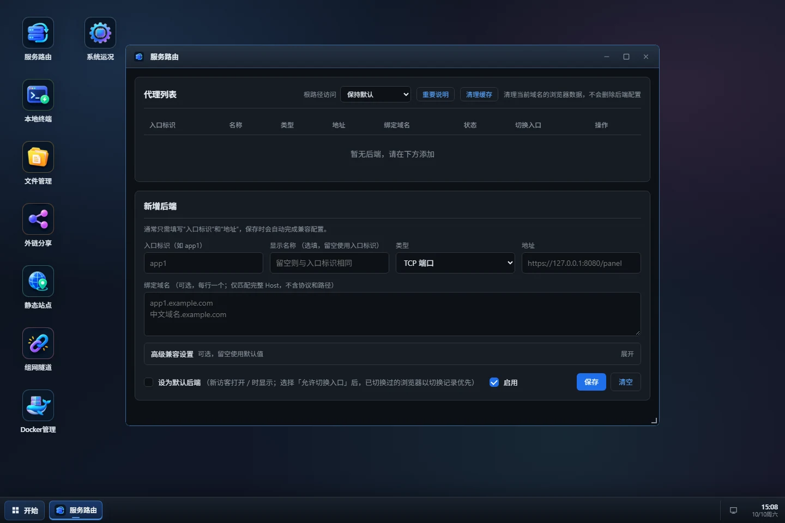

# M·Desk 使用手册

> **当前版本：** `2.3.27`
>
> M·Desk 是面向 NAS、家庭实验室与小型团队的自托管桌面系统。它把服务路由、终端、文件、分享、静态网站、组网隧道、Docker 与系统状态组织在同一套界面和操作习惯中。

> [!NOTE]
> 本手册只说明 M·Desk 的日常使用、部署与启动参数。FRPC、EasyTier、Cloudflare Tunnel 以及其它第三方服务的配置格式，请参考对应服务的官方文档。

## 快速导航

| 章节 | 内容 |
| --- | --- |
| [1. 应用介绍](#app-intro) | 产品定位、能力范围与准备事项 |
| [2. 模块使用说明](#module-guide) | 服务路由、组网、终端、文件、分享与静态网站 |
| [3. 部署与启动参数](#deployment) | 部署、参数、配置导入、运行维护与安全 |

---

<a id="app-intro"></a>

## 1. 应用介绍

### 1.1 主要用途

M·Desk 是一套自托管桌面系统，把常用的服务入口、运维操作与内容流转能力收束到同一张桌面里：

- 通过服务路由统一管理多个服务入口和域名绑定。
- 通过本地终端直接处理设备上的操作现场。
- 通过文件管理与外链分享承接文件流转和内容交付。
- 通过静态网站与组网隧道把服务发布到更远的地方。
- 通过 Docker 与系统状态持续观察设备运行情况。

### 1.2 功能总览

| 模块 | 说明 |
| --- | --- |
| **服务路由** | 统一管理服务入口、默认入口、域名绑定与快速切换，服务保持原有访问路径。 |
| **本地终端** | 浏览器里的多会话终端，支持后台保活、快捷命令、收藏夹与右键菜单。 |
| **文件管理** | 浏览、编辑、上传、下载、移动、复制、压缩与解压；支持右键菜单、框选和直接分享。 |
| **外链分享** | 为文件或目录生成分享链接，可设置访问密码、到期时间、启停状态和分享描述。 |
| **静态网站** | 把本地目录发布为静态网站，支持默认主页、目录浏览与域名绑定。 |
| **组网隧道** | 支持 FRPC、EasyTier 与 Cloudflare Tunnel；Cloudflare 支持命名隧道和快捷隧道。 |
| **Docker 管理** | 查看容器、镜像与运行状态，在桌面内完成常见管理操作。 |
| **系统状态** | 查看系统信息、硬盘、网络、资源监控与运行状态。 |

### 1.3 使用前须知

- 建议使用现代浏览器访问管理入口。
- 管理入口、终端与文件管理拥有较高权限，请使用强密码并妥善保存。
- 优先通过 HTTPS、内网 ACL、VPN 或零信任网关访问，不要将管理入口直接暴露在不可信网络中。
- 组网隧道涉及第三方服务账号、Token 或配置文件，请按对应官方文档妥善保管凭据。

---

<a id="module-guide"></a>

## 2. 模块使用说明

### 2.1 服务路由

服务路由用于统一管理多个服务入口。进入“服务路由”后，可以新增、编辑、启用、停用和删除服务，并设置默认入口。



#### 重要说明

- 服务地址支持 TCP 端口与 Unix Socket。
- 每个服务可以配置入口标识、显示名称、访问地址和域名绑定。
- 域名绑定支持每行一个域名或 IP，保存时会进行归一化与重复校验。
- 通过绑定域名访问时，根路径和子路径会优先路由到对应服务。

#### “默认”按钮是什么？

默认入口用于没有绑定域名、也没有明确切换目标时的兜底服务。列表中的“默认”按钮用于切换当前默认项，第一个新增的服务会自动成为默认项。

#### 高级兼容设置

服务路由会自动完成常见兼容配置。只有遇到登录异常、同名 Cookie、Token 登录或 iframe 嵌入问题时，才需要展开高级设置：

- **登录 Cookie**：多个服务使用相同 Cookie 名称时，填写各自的登录 Cookie，避免登录状态互相覆盖。
- **Token 登录**：目标服务使用 Token 而不是传统 Cookie 时配置。
- **Basic 登录适配**：上游需要用户名和密码时启用，由 M·Desk 验证后注入认证头。
- **Cookie 命名空间**：服务使用固定 Cookie 名称并发生冲突时启用。
- **清理缓存**：清理当前域名下的浏览器数据，不会删除服务配置。

### 2.2 组网隧道

“组网隧道”用于把本地服务安全地带到外网。当前支持 FRPC、EasyTier 与 Cloudflare Tunnel。

#### 基本操作

1. 选择 FRPC、EasyTier 或 Cloudflare Tunnel。
2. 填写对应服务需要的地址、端口、Token、配置文件或 Tunnel ID。
3. 保存并应用配置。
4. 使用状态切换按钮启动或停止隧道。
5. 在运行日志中查看连接状态和错误信息。

日志页面会自动更新。页面停留在底部时会跟随最新内容；向上滚动查看历史时会暂停跟随，回到最底部后恢复。

#### Cloudflare Tunnel

Cloudflare Tunnel 支持两种使用方式：

- **命名隧道**：适合长期使用，填写 Tunnel Token 或配置文件后保存并应用。
- **快捷隧道**：适合临时验证，只需要填写本地服务地址即可启动。

快捷隧道适合临时预览或调试，地址和生命周期由 Cloudflare 管理；需要固定入口时，建议使用命名隧道。

#### 配置来源

- 页面中保存的配置优先于启动参数。
- 使用 `-cf-token` 可以首次导入 Cloudflare 命名隧道 Token。
- 远程配置发生变化后，可以使用 `-force` 重新导入，或直接在模块中更新。

### 2.3 本地终端

本地终端提供浏览器中的多会话终端：

- 支持创建多个会话并在标签之间切换。
- 会话可以在后台保活，重新打开页面后继续使用。
- 右键菜单提供复制、粘贴、清屏、收藏夹、快捷命令、最大化和关闭会话。
- 支持常用命令收藏，减少重复输入。

终端拥有较高权限，请避免在共享浏览器中保存敏感命令或凭据。

### 2.4 文件管理

文件管理用于浏览和操作设备上的文件：

- 支持目录浏览、文件编辑、上传、下载、重命名、移动、复制、压缩和解压。
- 支持右键菜单、框选和全选，方便批量整理文件。
- 选中文件或目录后，可以直接创建分享链接。
- 支持收藏常用目录，减少重复定位。

### 2.5 外链分享

外链分享可以为文件或目录创建公开链接：

- 支持设置分享名称和分享描述。
- 支持设置访问密码。
- 支持设置到期时间。
- 支持随时暂停、恢复或删除分享。
- 可以从文件管理中直接选中文件或目录创建分享。

创建完成后，复制分享链接即可交付给访问者。需要控制访问范围时，建议同时启用访问密码和到期时间。

### 2.6 静态网站

静态网站用于把本地目录发布为网站：

- 选择一个本地目录作为网站根目录。
- 支持配置多个默认主页。
- 支持选择是否允许目录浏览。
- 支持绑定域名。

域名填写规则与服务路由一致：每行一个域名或 IP，不包含协议、端口、路径和通配符，并确保 DNS 已解析到 M·Desk。

---

<a id="deployment"></a>

## 3. 部署与启动参数

### 3.1 部署

Linux 命令行部署：

```bash
chmod +x ./MDesk-linux-amd64
./MDesk-linux-amd64
```

ARM64 设备请使用 `MDesk-linux-arm64`。默认监听 HTTP `9788` 端口，访问地址为：

```text
http://<设备地址>:9788/@admin
```

fnOS 用户可以在应用中心安装 `mdesk_<版本>.fpk`，安装过程中可选择 HTTP 或 HTTPS，并调整监听端口。

### 3.2 首次使用

1. 打开管理入口。
2. 设置管理密码。
3. 进入桌面后按需配置服务路由、终端、文件管理、分享、静态网站、组网隧道、Docker 与系统状态。

### 3.3 启动参数

| 参数 | 说明 |
| --- | --- |
| `-scheme` | 设置 HTTP 或 HTTPS |
| `-port` | 设置监听端口，默认 `9788` |
| `-data` | 设置数据目录 |
| `-log` | 设置日志文件 |
| `-cf-token` | 首次导入 Cloudflare 命名隧道 Token |
| `-force` | 覆盖已有配置并重新导入 |

### 3.4 常用启动示例

修改端口：

```bash
./MDesk-linux-amd64 -port 8080
```

指定数据目录：

```bash
./MDesk-linux-amd64 -data /vol1/mdesk-data
```

启用 HTTPS：

```bash
./MDesk-linux-amd64 -scheme https -port 9443
```

### 3.5 配置导入规则

- 管理页面中保存的配置优先于启动参数。
- 启动参数适合首次初始化或批量部署。
- 修改配置后，建议先保存并应用，再重启相关模块。
- 重要配置请定期备份数据目录。

### 3.6 运行、停止与重复启动

- 前台运行时，关闭进程会停止服务。
- 使用 fnOS 或系统服务管理时，可以通过应用中心或服务管理工具启停。
- 重复启动前请确认端口没有被其它进程占用。

### 3.7 数据目录、升级与备份

数据目录中保存管理配置、服务路由、分享、隧道和运行数据。升级前建议：

1. 停止 M·Desk。
2. 备份整个数据目录。
3. 安装新版本并启动。
4. 检查服务路由、终端、文件管理、分享和隧道状态。

### 3.8 安全建议

- 使用强密码，不要复用其它服务的密码。
- 优先通过 HTTPS 访问管理入口。
- 不要将管理入口直接暴露在不可信网络中。
- 定期检查分享链接、域名绑定和隧道配置。
- 妥善保管 Cloudflare Token、FRPC 配置和 EasyTier 凭据。
