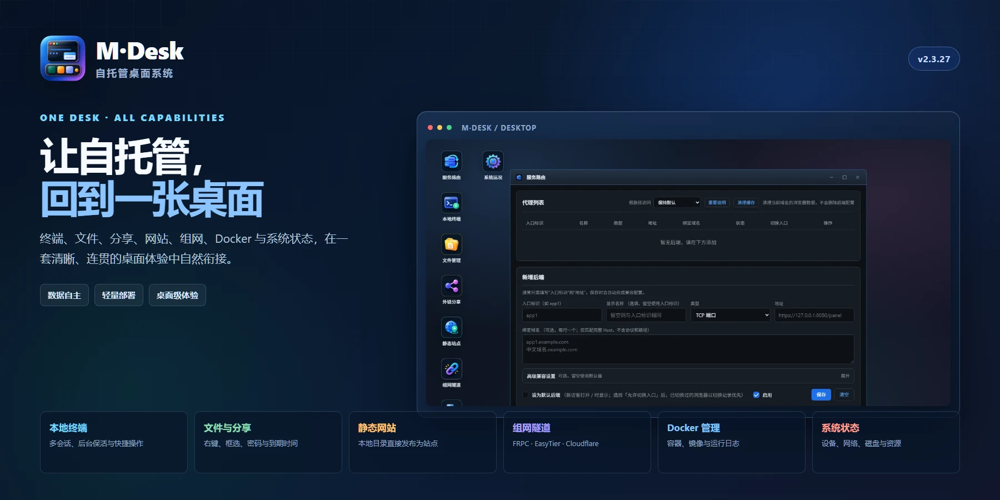

<p align="center">
  
</p>

<h1 align="center">M·Desk</h1>

<p align="center">面向自托管场景的桌面系统</p>

<p align="center">
  <a href="https://github.com/IMGZCQ/MDesk/releases">下载</a>
  ·
  <a href="./MDesk%20使用手册.md">使用手册</a>
  ·
  <a href="https://github.com/IMGZCQ/MDesk/issues">问题反馈</a>
</p>

> [!NOTE]
> M·Desk 将服务路由、终端、文件、分享、静态网站、组网隧道、Docker 与系统状态收束到同一套桌面体验中，面向 NAS、家庭实验室、小型团队和重视数据自主的个人用户。

<p align="center"><strong>当前版本：2.3.28</strong></p>

<p align="center">
  
</p>

## 快速入口

| 入口 | 说明 |
| --- | --- |
| [下载最新版本](https://github.com/IMGZCQ/MDesk/releases) | 获取对应平台安装包与可执行文件 |
| [完整使用手册](./MDesk%20使用手册.md) | 模块操作、部署方式与启动参数 |
| [问题反馈](https://github.com/IMGZCQ/MDesk/issues) | 提交问题、建议与使用反馈 |

---

## 核心能力

| 模块 | 说明 |
| --- | --- |
| **服务路由** | 统一管理多个服务入口，支持域名绑定与快速切换，各服务保持原有访问路径。 |
| **本地终端** | 浏览器中的多会话终端，支持后台保活、快捷命令与右键菜单操作。 |
| **文件管理** | 在线浏览、编辑、上传下载、压缩解压；支持右键菜单、框选和直接分享。 |
| **外链分享** | 为文件或目录生成分享链接，可设置访问密码、到期时间、启停状态。 |
| **静态网站** | 选择一个本地目录即可发布为静态网站，支持默认主页、目录浏览与域名绑定。 |
| **组网隧道** | 支持 FRPC、EasyTier 与 Cloudflare Tunnel；Cloudflare 支持命名隧道和快捷隧道。 |
| **Docker 管理** | 在同一桌面中查看容器、镜像与运行状态，减少在多套工具之间切换。 |
| **系统状态** | 集中展示系统信息、硬盘、网络与资源监控数据，让运行情况保持清晰可见。 |

---

## 快速开始

### Linux 命令行

1. 从 [Releases](https://github.com/IMGZCQ/MDesk/releases) 下载匹配架构的 `MDesk-linux-amd64` 或 `MDesk-linux-arm64`。
2. 将文件放到可写目录，确保同级目录能够创建 `data` 数据目录。
3. 赋予执行权限并启动：

```bash
chmod +x ./MDesk-linux-amd64
./MDesk-linux-amd64
```

4. 默认监听 HTTP `9788` 端口，访问 `http://<设备地址>:9788/@admin`。
5. 首次访问时设置管理密码。

ARM64 设备请将文件名替换为 `MDesk-linux-arm64`。可通过 `-scheme`、`-port`、`-data` 和 `-log` 调整访问协议、监听端口、数据目录和日志文件，完整参数见 [MDesk 使用手册](./MDesk%20使用手册.md)。

### fnOS 安装包

1. 从 [Releases](https://github.com/IMGZCQ/MDesk/releases) 下载最新的 `mdesk_<版本>.fpk`。
2. 在 fnOS 应用中心手动安装。
3. 安装过程中可选择 HTTP 或 HTTPS，默认使用 HTTP 和 `9788` 端口。
4. 安装完成后访问 `http://<设备地址>:9788/@admin`，首次访问时设置管理密码。

服务路由、终端、文件管理、外链分享、静态网站、组网隧道、Docker 与系统状态的详细操作，请查看 [MDesk 使用手册](./MDesk%20使用手册.md)。

---

## 仓库结构

```text
app/bin/               Linux amd64 / arm64 运行文件
app/ui/                fnOS 桌面入口、图标与应用配置
cmd/                   fnOS 安装、升级、卸载生命周期脚本
config/                fnOS 权限与资源配置
wizard/                fnOS 安装、配置与卸载向导
manifest               fnOS 应用清单
ICON.PNG               项目图标
poster.webp            功能概览海报
1.webp - 7.webp        功能截图
MDesk 使用手册.md      用户使用、部署与参数说明
```

---

## 发布说明

本仓库用于保存 M·Desk 的 fnOS 发布结构、运行文件、应用图标、功能截图与使用文档，不包含 Go 源码。发布文件可直接用于应用安装包制作与版本分发。

> [!CAUTION]
> M·Desk 的管理入口、终端与文件管理拥有较高权限。请使用强密码，优先通过 HTTPS、内网 ACL、VPN 或零信任网关访问，不要将管理入口直接暴露在不可信网络中。
