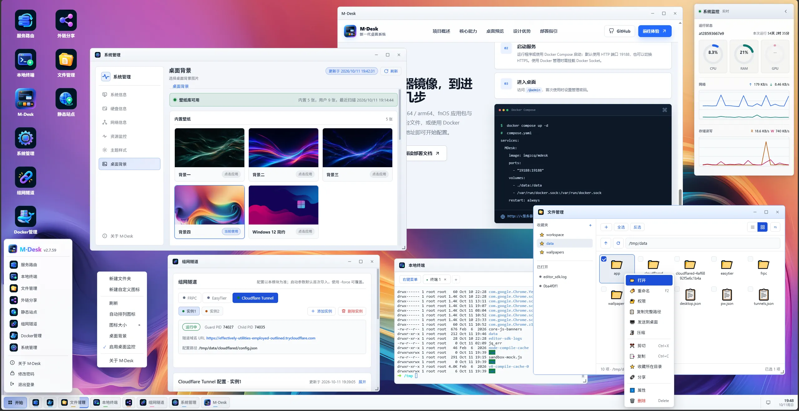
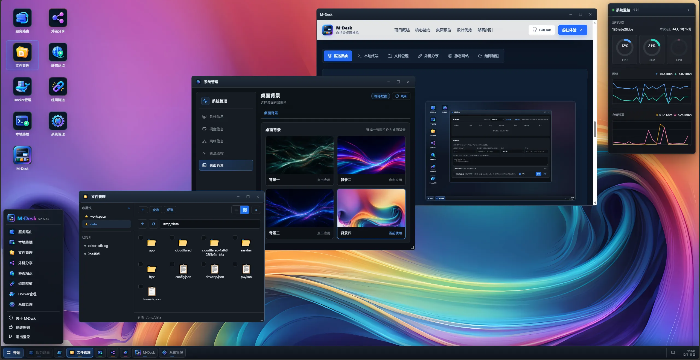

<p align="center">
  
</p>

<h1 align="center">M·Desk</h1>

<p align="center">高效轻便的服务器运维桌面系统</p>

<p align="center">
  <a href="https://github.com/IMGZCQ/MDesk/releases">下载</a>
  ·
  <a href="./MDesk%20使用手册.md">使用手册</a>
  ·
  <a href="https://github.com/IMGZCQ/MDesk/issues">问题反馈</a>
</p>

<p align="center">
  
</p>

## 桌面系统总览

<p align="center">
  
</p>

<p align="center">
  
  
</p>

M·Desk 一个高效轻便的服务器运维桌面系统；集结反代服务、本地终端、组网穿透、分享收集、静态网站、文件和 Docker 管理等服务；所有服务都基于单一端口实现，享受极致的管理体验！

## 快速入口

| 入口 | 说明 |
| --- | --- |
| [下载最新版本](https://github.com/IMGZCQ/MDesk/releases) | 获取对应平台安装包与可执行文件 |
| [完整使用手册](./MDesk%20使用手册.md) | 模块操作、部署方式与启动参数 |
| [问题反馈](https://github.com/IMGZCQ/MDesk/issues) | 提交问题、建议与使用反馈 |

---

## 核心能力

| 模块 | 说明 |
| --- | --- |
| **服务路由** | 统一管理多个服务入口，支持域名绑定与快速切换，各服务保持原有访问路径；桌面图标可从 Web Manifest、`srcset`、JSON-LD 与页面图像中自动识别，并支持桌面资源上传与安全校验。 |
| **应用中心与 fnOS 接入** | 应用中心按 M·Desk 原生应用、1Panel 源与 CasaOS 源清晰分区，安装、升级与卸载弹窗显示真实应用图标，详情分列作者和开发者；三方订阅源支持名称自动获取和地址协议自动补全。应用中心来源的桌面图标右键可打开应用信息。扫描 fnOS 应用中心，将端口、Unix Socket 与 CGI 应用接入桌面，支持应用图标、版本、访问入口与安全路径校验。MPK 图标按文件内容校验，持续完善应用包规范与非 fnOS 环境兼容性。 |
| **本地终端** | 浏览器中的多会话终端，支持后台保活、快捷命令与右键菜单操作；快捷命令内容使用默认两行、可垂直拖拽的多行输入框；文件管理空白区右键可打开终端并自动定位当前目录。常见 POSIX 环境优先使用 Bash，同时保留 Zsh 等显式 shell 选择。 |
| **文件管理** | 在线浏览、编辑、上传下载、压缩解压；侧栏通过“目录 / 收藏 / 已打开”标签切换，目录支持双击展开和收起，工具栏图标统一为 `34×34` 按钮与 `28×28` 图标。支持多窗口与同目录窗口复用，每个窗口独立保存路径、选择、排序和视图状态，文件操作仅刷新受影响窗口，`F5` 刷新当前激活窗口。复制、移动和上传冲突支持跳过、覆盖或保留两者；目录冲突递归合并，跨分区移动会先校验副本再删除源文件。编辑器支持多文件独立编辑与未保存内容确认。上传、下载、复制和移动任务集中进入统一任务中心；支持右键菜单、框选、直接创建分享收集，以及图片、音视频和文本预览；音频播放器支持封面、歌曲信息、播放列表、歌词、搜索、随机与循环播放。列表与图标视图按需懒加载图片缩略图；图片支持左右滑动或相册前后切换并循环浏览、缩放平移和键盘操作，相邻图片预加载并兼容 HEIC；视频支持桌面与公开分享页共用的触控手势。 |
| **分享收集** | 支持分享、收集和“都要”三种模式：分享用于浏览下载，收集仅提供访客上传区，“都要”同时开放两者；收集模式支持 `1 MB` 至 `100 GB` 单文件上限、超限提示与同名文件自动重命名，仅单个实际目录可启用。管理员可设置上传文件后缀白名单或黑名单，默认阻止可执行文件、脚本等高风险文件直接上传。分享管理列表直接显示分享地址，编辑带密码的分享时可以查看已保存的访问密码。目录页可切换列表与图标视图，图标和文件名均可打开预览且间距紧凑，并可选择当前页条目打包下载。分享登录会话具有有效期，在退出、密码或安全设置变化后立即失效；音频与歌词请求继续受分享权限保护并支持分段读取。 |
| **静态网站** | 选择一个本地目录即可发布为静态网站，支持默认主页、目录浏览与域名绑定；目录页支持列表与图标视图，站点中的图片、音视频和文本资源可直接预览；音频播放器支持播放列表、歌词、搜索、随机与循环播放。 |
| **组网隧道** | 支持 FRPC、FRPS、EasyTier 与 Cloudflare Tunnel，并可分别管理多个实例；FRP 服务端与客户端共用下载和校验流程，Cloudflare 的命名隧道与临时隧道使用更清晰的单选方式。 |
| **Docker 管理** | 管理容器、Compose 项目、本地镜像、镜像仓库、Docker 网络与镜像加速器；支持按镜像、Compose 服务或容器逐项检测更新、拉取新镜像并重建服务，也支持重启 Docker 服务。 |
| **进程管理** | 查看真实进程列表、PID、用户、状态、CPU、内存、启动时间与可执行路径；支持搜索、端口反查、排序筛选、详情与安全结束进程。进程、服务与端口长列表支持在空白区域拖动滚动，同时保留按钮、下拉选择与右键菜单操作；后台轮询采用局部刷新，搜索框、光标位置和展开中的下拉框不会被打断。 |
| **系统状态** | 集中展示系统与硬件信息、硬盘和 SMART 健康、网络接口与流量、CPU、内存、GPU 与资源趋势，网络总览新增公网 IP 与归属地；后台统一采样记录 CPU、内存、GPU、网络和磁盘读写趋势。新增系统服务管理，可查看 systemd 与 Windows 服务的运行状态和启动类型，支持搜索、筛选、排序、详情、启停、重启及开机启动调整，并对并发操作、权限限制和平台不支持项提供明确反馈。Linux 支持 Swap 路径、类型、容量与使用率查看，并可调节虚拟内存使用倾向、安全启停和调整单个 Swap 文件容量。服务列表实时刷新时保持当前滚动位置。 |
| **系统设置与个性化** | 新增独立“界面外观”设置，提供经典、紧凑、宽松三种尺寸密度，以及经典、Win11、macOS、霓虹、终端控制台、纸面工作台六种界面风格，选择即时生效并自动保存。系统设置另提供八套应用图标套装，包含 V8“极简风格”，可切换桌面图标单击或双击打开；支持指定独立壁纸目录，也可拖放或批量上传 JPG、PNG、GIF、WebP 壁纸并立即刷新列表。窗口按桌面可用工作区进行最大化、分屏、拖拽与缩放，兼容悬浮任务栏，窗口焦点、吸附状态和后台刷新策略会随桌面操作平滑调整；应用中心安装或卸载应用时自动同步桌面图标。 |

---

## 快速开始

### 发布文件

| 平台 | 文件 | 说明 |
| --- | --- | --- |
| Windows 服务版 | `MDesk-Windows-Service.exe` | 在后台提供管理服务，适合长期运行 |
| Windows 桌面版 | `MDesk-Windows-Desktop.exe` | 使用桌面窗口承载管理界面 |
| Linux amd64 | `MDesk-linux-amd64` | 适用于常见 x86_64 设备 |
| Linux arm64 | `MDesk-linux-arm64` | 适用于 ARM64 设备 |
| Linux armv7 | `MDesk-linux-armv7` | 适用于 32 位 ARMv7 设备 |
| fnOS | `MDesk_2.7.138.fpk` | 支持 amd64 与 arm64 |

### Linux 命令行

1. 从 [Releases](https://github.com/IMGZCQ/MDesk/releases) 下载匹配架构的 `MDesk-linux-amd64`、`MDesk-linux-arm64` 或 `MDesk-linux-armv7`。
2. 将文件放到可写目录，确保同级目录能够创建 `data` 数据目录。
3. 赋予执行权限并启动：

```bash
chmod +x ./MDesk-linux-amd64
./MDesk-linux-amd64
```

4. 默认监听 HTTP `19188` 端口，访问 `http://<设备地址>:19188/@admin`。
5. 首次访问时设置管理密码。

ARM64 设备请将文件名替换为 `MDesk-linux-arm64`，32 位 ARMv7 设备请使用 `MDesk-linux-armv7`。可通过启动参数调整访问协议、监听地址、数据目录、日志和组网配置，完整说明见 [MDesk 使用手册](./MDesk%20使用手册.md)。

### Linux 一键安装（systemd / OpenRC / SysV）

一键安装会自动识别 `amd64`、`arm64` 或 `armv7`。脚本会优先从 `https://fndesk.imcq.top/FPK/MDesk/` 下载对应二进制文件；如果该镜像不可用，再回退到 GitHub Release 的多个加速地址中选择可用且响应较快的线路。安装时会优先使用 systemd，并兼容 OpenRC、SysV；所选服务管理器注册、启动或健康检查失败时，会自动降级为独立后台进程。后台模式会在 cron 可用时注册 `@reboot` 启动；若系统同时没有 cron，后台进程仍可正常使用，但系统重启后需要手动执行 `sudo mdeskctl start`，这是缺少 init/服务管理器时的系统限制。

```bash
curl -fsSL https://raw.githubusercontent.com/IMGZCQ/MDesk/main/install.sh | sudo bash
```

再次运行同一命令时，脚本会先检测系统是否已经安装 MDesk：

- 未安装时，直接进入安装向导。
- 已安装时，显示管理菜单，可选择重新安装/升级、卸载或取消。

也可以使用显式命令强制安装或卸载：

```bash
sudo bash install.sh install
sudo bash install.sh uninstall
```

安装向导会依次询问：

1. 服务端口，直接回车使用默认值 `19188`
2. 安装目录，直接回车使用默认值 `/opt/MDesk`

安装目录建议使用不含空格和特殊字符的路径，例如 `/opt/MDesk`。

安装完成后会按当前环境注册并启动服务，并在服务管理器或 cron 可用时设置为开机自动启动。管理后台地址为：

```text
http://<设备地址>:<端口>/@admin
```

如需强制使用某个服务模式，可设置 `MDESK_SERVICE_MODE`：

```bash
sudo env MDESK_SERVICE_MODE=systemd bash install.sh
sudo env MDESK_SERVICE_MODE=openrc bash install.sh
sudo env MDESK_SERVICE_MODE=sysv bash install.sh
sudo env MDESK_SERVICE_MODE=process bash install.sh
```

升级或重新安装会交给独立后台任务执行，因此即使 MDesk 内置终端、SSH 会话或发起命令的终端断开，更新仍会继续。任务会下载并校验新二进制、重启服务并执行 HTTP 健康检查；失败时会恢复旧二进制和配置，如果原服务管理器仍无法启动，则会自动用后台进程恢复旧版本。可使用以下命令发起或查看更新：

```bash
sudo bash install.sh update
sudo mdeskctl update
sudo mdeskctl status
```

更新日志和最近状态分别保存在 `/etc/mdesk/update.log` 与 `/etc/mdesk/update.status`。

卸载命令：

```bash
sudo mdeskctl uninstall
```

也可以使用本地脚本卸载：`sudo bash install.sh uninstall`。

卸载向导会询问是否删除用户数据。默认保留数据；选择删除后，会清理安装目录中的数据。

如需指定 GitHub 加速地址，可使用英文逗号分隔，并支持 `{url}` 占位符：

```bash
curl -fsSL https://raw.githubusercontent.com/IMGZCQ/MDesk/main/install.sh |
  sudo env MDESK_GITHUB_PROXY='https://gh-proxy.com/,https://ghfast.top/' bash
```

### 常用启动参数

| 参数 | 说明 |
| --- | --- |
| `-scheme` | 设置 HTTP 或 HTTPS，默认 `http` |
| `-addr` | 设置完整监听地址，例如 `127.0.0.1:8080` 或 `:8080`；与 `-port` 二选一，`-addr` 优先 |
| `-port` | 设置监听端口，默认 `19188` |
| `-data` | 设置数据目录，默认使用程序所在目录下的 `data` |
| `-log` | 设置运行日志文件；按 5MB 轮转并保留 3 份 |
| `-reset-password` | 重置管理密码后退出程序 |
| `-frpc-config` | 首次导入 FRPC 配置文件，支持本地路径或 HTTP(S) URL |
| `-frps-config` | 首次导入 FRPS 配置文件，支持本地路径或 HTTP(S) URL |
| `-easytier-config` | 首次导入 EasyTier 配置文件，支持本地路径或 HTTP(S) URL |
| `-cf-token` | 首次导入 Cloudflare 命名隧道 Token |
| `-force` | 强制使用命令行中的组网隧道配置覆盖已有模块配置 |

Docker 管理建议在 Docker 所在 Linux 宿主机上运行，并确保 M·Desk 进程拥有 Docker Socket 的读写权限。

### 可选环境变量

| 环境变量 | 说明 |
| --- | --- |
| `MDESK_GITHUB_PROXY` | 组网工具下载代理，多个地址使用英文逗号分隔；设置后会替换内置代理列表，并支持 `{url}` 占位符 |
| `MDESK_GITHUB_TOKEN` | 可选的 GitHub Token，优先于 `GITHUB_TOKEN`，用于提高 GitHub API 和下载请求限额 |
| `GITHUB_TOKEN` | `MDESK_GITHUB_TOKEN` 未设置时使用 |
| `DOCKER_SOCKET` | 自定义 Docker Unix Socket 路径 |
| `DOCKER_HOST` | 仅支持 `unix://...` 形式，暂不支持 TCP 连接 |
| `DOCKER_DAEMON_CONFIG` | 自定义 Docker daemon 配置文件路径，默认 `/etc/docker/daemon.json` |

### Docker 镜像

GitHub Actions 会在发布 Release 时自动读取该 Release 的 `MDesk-linux-amd64`、`MDesk-linux-arm64` 与 `MDesk-linux-armv7` 资产，构建并推送 `linux/amd64`、`linux/arm64` 与 `linux/arm/v7` 多架构镜像到 Docker Hub：

#### Docker Compose

创建 `compose.yaml`：

```yaml
services:
  MDesk:
    container_name: MDesk
    image: imgzcq/mdesk
    network_mode: host                              # 网络类型
    restart: always                                 # 自动启动
    command: ["-port", "19188"]                     # 自定义端口
    volumes:
      - /var/run/docker.sock:/var/run/docker.sock   # Docker管理
      - ./data:/usr/local/bin/data                  # 应用数据持久化
      #- /var/apps:/var/apps                        # 接入飞牛应用
      #- /vol1:/vol1                                # 接入飞牛应用
```

> 提示：飞牛应用相关挂载默认注释，非飞牛系统保持注释即可。在 fnOS 中使用应用接入时，取消这两行注释，并将 `/vol1` 调整为应用实际所在的存储卷；存在多个存储卷时分别挂载对应的 `/volX`。

> 提示：`command` 会覆盖镜像默认的 `-data /data` 参数，程序因此使用可执行文件所在目录下的 `data`，即 `/usr/local/bin/data`。请保持 `volumes` 挂载路径为 `./data:/usr/local/bin/data`，确保配置、账号与图标等数据持久化。

启动：

```bash
docker compose up -d
```

`/var/run/docker.sock` 用于 M·Desk 的 Docker 管理功能。不需要该功能时可以移除这一行，但容器、Compose、镜像与网络页面将无法连接宿主机 Docker。

> [!CAUTION]
> 挂载 Docker Socket 后，M·Desk 将拥有较高的宿主机控制权限。请只运行可信镜像，限制管理入口的访问范围，并妥善保护管理密码与访问链路。

#### Docker Run

```bash
docker pull imgzcq/mdesk:latest

docker run -d \
  --name mdesk \
  --restart unless-stopped \
  -p 19188:19188 \
  -v mdesk-data:/data \
  -v /var/run/docker.sock:/var/run/docker.sock \
  imgzcq/mdesk:latest
```

Docker 管理需要挂载 Docker Socket。文件管理与终端默认只看到容器内文件，如需管理宿主机目录，请额外挂载对应卷。

仓库 Actions secrets 需要配置 `DOCKERHUB_TOKEN`，建议使用 Docker Hub 的 Read & Write access token。Release 发布会推送 `latest`、版本号和完整标签；也可以通过 `workflow_dispatch` 手动补发指定版本，版本号填写 `2.7.114` 或 `v2.7.114` 均可。

### fnOS 安装包

1. 从 [Releases](https://github.com/IMGZCQ/MDesk/releases) 下载最新的 `MDesk_2.7.138.fpk`。
2. 在 fnOS 应用中心手动安装。
3. 安装过程中可选择 HTTP 或 HTTPS，默认使用 HTTP 和 `19188` 端口。
4. 安装完成后访问 `http://<设备地址>:19188/@admin`，首次访问时设置管理密码。

服务路由、终端、文件管理、分享收集、静态网站、组网隧道、Docker、进程管理与系统状态的详细操作，请查看 [MDesk 使用手册](./MDesk%20使用手册.md)。

---

## 项目结构

```text
.github/workflows/     Docker Hub 多架构发布流程
app/                   fnOS 应用运行文件与三架构二进制
cmd/                   fnOS 安装、启动、升级与卸载脚本
config/                fnOS 权限与资源声明
wizard/                fnOS 安装向导配置
Dockerfile             Docker Hub 多架构镜像构建文件
manifest               fnOS 应用清单
MDesk 使用手册.md      用户使用、部署与参数说明
```

---

## 官网

官网源码由本地 `www/` 目录维护，可以直接部署为静态站点。页面包含项目介绍、核心能力、优势说明、部署概览与响应式布局，所有文案均在 `www/index.html` 中维护；发布仓库不包含该目录。

> [!CAUTION]
> M·Desk 的管理入口、终端与文件管理拥有较高权限。请使用强密码，优先通过 HTTPS、内网 ACL、VPN 或零信任网关访问，不要将管理入口直接暴露在不可信网络中。

> [!NOTE]
> 将管理入口改为自定义路径后，默认 `/@admin` 会释放为普通路径：绑定 Host 时按原路径反代或访问静态站点，否则进入默认代理链；旧路径不再执行登录、会话或管理页面逻辑，也不再附加管理专用 CSP、X-Frame-Options 或 no-store 响应头。`/@mdesk` 和 `/@app` 不可设置为管理入口。
> 服务健康检查固定使用 `GET/HEAD /@mdesk/healthz`，与管理入口路径无关；一键安装脚本也使用该端点探测启动状态。

## 更新日志

### 2.7.138

- 移植Fndesk音乐播放器，支持封面与歌曲信息、播放列表、歌词、搜索、随机及循环播放；文件管理、静态网站、分享目录、收集页和单文件分享均可使用。
- 完善音频与歌词的分享权限校验，并支持大文件分段读取。
- 新增 V8“极简风格”系统图标套装，及其他样式细节调整。
- 登录支持 30 分钟无操作自动登出，以及 12 小时至 7 天的保持登录；退出或修改密码后旧会话立即失效。
- 远程接管断线时显示明确状态和重连入口，避免主界面白屏。

### 2.7.137

- 系统设置支持虚拟内存使用倾向调节。
- 桌面背景支持拖放或批量上传 JPG、PNG、GIF、WebP 图片，自动校验并立即刷新壁纸列表。
- 文件管理侧栏调整为“目录 / 收藏 / 已打开”标签切换。
- 分享管理列表直接显示分享地址，编辑带密码的分享时可查看已保存的访问密码。
- Cloudflare Tunnel 的命名隧道和临时隧道选择改为更清晰的单选方式。
- 系统状态的服务列表在实时刷新时保持拖动滚动位置，避免列表跳动。
- 完善飞牛 FPK 管理入口同步，本机入口记录过期时仍能自动校正飞牛桌面入口。
- 微调桌面监控小组件样式。

### 2.7.136

- 在飞牛 FPK 安装环境中，修改管理入口后会自动同步飞牛桌面应用的打开入口。
- 域名绑定支持直接粘贴完整网址，自动提取域名，并增强中文域名、端口和 IPv6 地址处理；修正自定义管理入口后的普通路径路由。
- 新增 V7“云朵拟物”应用图标套装，并完善界面外观与细节样式。
- 分享收集支持管理员配置上传文件后缀策略，可选择允许或禁止指定后缀，并默认阻止可执行文件、脚本等高风险文件直接上传。
- 修复文件上传完成后目录未及时刷新的问题，上传成功后会刷新当前文件列表。
- 分享登录会话增加有效期，并在退出、密码或安全设置变化后立即失效，提升分享访问的安全一致性。
- 完善分享页面的说明文案和密码处理流程，并新增“退出登录”入口，退出后立即清除当前分享会话。
- 优化 MPK 商店页面的目录更新跟踪、主题偏好和详情链接处理。
- 桌面右键菜单新增“全屏/退出全屏”切换。

### 2.7.133

- 统一模态对话框回车行为：普通输入回车触发当前对话框主按钮，文本框、按钮及显式本地控件保留自身行为，阻止事件穿透文件列表；目录选择器和 MPK 三方源输入也按局部规则处理。管理入口对话框新增“默认”按钮，一键填入 `@admin`；接口层兼容标准信封与原始成功响应，旧接口或代理返回不会被误判为空。
- 应用中心支持一次拖入一个 `.mpk` 安装包，带覆盖提示、扩展名与忙碌状态校验；详情页改为内嵌返回布局并修正返回按钮边框，本地安装、在线安装与升级使用真实应用图标，安装完成后兼容服务端返回的应用状态包装。
- 分享收集目录默认使用图标视图，修正图标网格与列表布局；列表/图标视图选择状态同步，继续支持全选、取消选择和选中项打包下载。
- 管理入口改变后，桌面图标图片地址会自动归一化和重映射，兼容旧的 `/@admin` 绝对地址与根相对地址，并拒绝非法图片 URL。
- 调整对话框宽度、Docker 内容隔离与界面字体偏移等细节，移除文件及工具压缩包解压的 1 GiB 总量硬上限以支持更大内容，并更新静态资源缓存版本以确保新前端内容及时加载。

### 2.7.132

- 新增独立健康检查端点 `GET/HEAD /@mdesk/healthz`：返回 `ok` 且 `Cache-Control: no-store`，不依赖自定义管理入口，并保留为本地控制面路径；安装脚本改用该端点探测服务启动。
- 管理静态资源缺失或请求目录时改为统一状态页，避免裸文件服务错误；自定义管理入口下的资源路由继续按当前入口处理。
- `mpkpack store` 生成的商店列表页增强：原子写入、主题偏好持久化、目录更新追踪、详情包引用、空/缺失图标回退和准确体积格式化。
- 按权威 `store_metadata.json` 同步 25 个 MPK 的名称、架构、作者与开发者，修正 11 个包的作者/开发者字段，并重新生成全部详情、索引与商店列表页。
- 重新编译 mpkpack 六平台工具，更新官网下载表和 `checksums.txt`；同步更新官网、README、使用手册、manifest 与本地商店内容。

### 2.7.131

- 管理入口改为自定义路径后，旧 `/@admin` 与管理功能完全脱钩，按普通路径参与域名反代、静态站点或默认代理；旧路径不能登录、不再被保留为管理入口或返回 404，也不再附加管理专用安全响应头；`/@mdesk` 和 `/@app` 被列为不可用管理入口。
- 文件管理侧栏目录支持双击展开和收起，空白区右键新增“打开终端”并自动定位当前目录；终端初始化增加并发保护，快捷命令内容改为默认两行、可垂直拖拽的多行输入框。
- 文件管理工具栏图标统一为 `34×34` 按钮和 `28×28` 图标；分享目录图标视图中图标与文件名共用预览入口并压缩间距，同时完善选中打包的去重、多根目录、密码保护和请求限制校验。
- MPK 图标改为按文件内容识别，支持 GIF、AVIF、BMP、ICO、HEIC/HEIF、TIFF、JPEG XL、PNG、JPEG、WebP、SVG 等可识别图片；安装检查返回真实 `iconDataURL`，本地及在线安装、升级、卸载弹窗显示应用图标并保留加载失败回退。
- 应用中心详情分列作者和开发者，管理订阅按钮统一为主按钮样式；应用中心来源的桌面图标右键新增“应用信息”，可直达已安装应用详情。
- 桌面 10 个系统应用图标移除刷新系统、代理、站点、分享、隧道、Docker、文件、应用列表及新建终端等专属右键项，仅保留打开、固定到任务栏和移除。
- 官方 MPK 商店新增三阶魔方 `0.90.0`、3D弹球 `1.2.0`、切碎方块 `0.90.0`、植物大战僵尸：年度版 `0.2.1`、打砖块3D版 `1.0.0` 和压爆只雀 `0.90.0`，均同步索引、详情、图标与安装包。
- 开发者文档补充任意可识别图片图标规范；同步更新官网、README、使用手册与默认提示中的文件管理和分享收集说明。

### 2.7.130

- 分享能力升级为“分享收集”：支持分享、收集和“都要”三种模式；收集页不暴露目录，访客可按 `1 MB` 至 `100 GB` 上限上传，同名文件自动重命名，路径不是单个实际目录时自动限制为纯分享；文件管理右键可直接创建分享收集。
- 公开分享与静态网站目录新增列表和图标视图；分享目录支持当前页全选、不选及只打包下载选中项，静态网站目录仅保留视图切换；纯收集页不暴露文件列表和下载入口。
- 文件管理、桌面图片快捷方式、分享与静态网站目录统一接入图片缩略图：默认图标先行，进入可视区后懒加载缩略图，打开图片按“缩略图 → 原图”过渡，并集中处理缓存与失效。
- 修复系统管理轮询导致搜索框、下拉框和表单焦点丢失：进程、端口、服务刷新改为局部更新，输入框保留光标与选区，展开中的下拉框延后刷新。
- 修复 1Panel/CasaOS 安装被 `staged package ticket` 误拦截：仅官方源与三方 MPK 使用一次性安装票据，Compose 兼容源继续直接安装。
- 强化 MPK 清单与商店元数据校验，补齐版本比较、架构归一化、`open mode`、store 缺省字段和 Compose 安全规则；重新发布 mpkpack 六平台版本与校验文件。
- 官方应用源新增 DDNS-GO `6.17.7`、frpc/frps `0.71.1` 和 Syncthing `2.1.7`，并同步静态商店页、图标与安装包。
- 统一“外链分享”为“分享收集”命名，放大文件管理返回上级按钮，并修正分享列表空状态、模式徽标和右键入口等界面细节。

### 2.7.129

- 桌面媒体窗口与公开分享页统一图片预览体验，支持左右滑动或相册前后切换并循环浏览、缩放平移、双击与滚轮缩放、触控捏合和键盘操作，并加入相邻图片预加载、HEIC 兼容和明确的加载失败提示。
- 公开分享图片可直接定位到指定图片，并在当前相册中继续前后浏览。
- 桌面端与公开分享页统一视频触控手势：单击播放或暂停、双击切换全屏、长按临时 2 倍速、横向拖动快进快退，左侧上下调节亮度、右侧上下调节音量，普通与全屏模式保持一致。
- 新建外链分享默认启用到期时间并预填 7 天后，仍可快速选择 1 天、3 天、7 天、1 个月或自定义时间。

### 2.7.128

- 组网穿透新增 FRPS 支持，与 FRPC 并列配置，并支持实例隔离、日志、自动启动和内核更新。
- 应用中心三方订阅源支持名称自动获取、地址协议自动补全，并新增“获取应用源”入口，同时保留“成为开发者”入口。
- 在线应用商店支持版本识别与在线升级，显示已安装版本和目标版本，下载一次后进入升级向导；升级保留数据并迁移配置。
- MPK 安装与升级改为票据化暂存流程，支持取消、超时和失败清理，安装配置在最终提交时生效。
- 文件管理新增搜索：支持当前目录或子树、文件名与相对路径、文件或目录筛选、隐藏文件选项，并提供超时与结果数量限制。
- 外链分享和静态网站目录新增分页，可选择每页 10、20、50 或 100 条；桌面端默认 20 条，移动端默认 10 条，切换页面保留查询参数。
- 有运行中的任务或未保存的编辑器文件时，关闭页面会先提示，降低误关闭导致任务或草稿丢失的风险。
- 应用源可生成独立的静态商店页，包含响应式布局、主题切换、应用详情、应用源地址展示与一键复制，以及安装包下载。
- 开发者工具 `mpkpack` 发布 Windows、Linux、macOS 多架构版本，并提供校验文件。
- 官方应用商店新增或升级：Angry Birds 2 `1.0.0`（amd64）；Lucky `3.4.2`（amd64、arm64、armv7）；Nginx UI `1.0.2`（amd64、arm64）；OpenList `1.0.6`（amd64、arm64）；WorkBuddy `5.6.3`（amd64、arm64）。
- 修复文件上传跳过策略：只跳过真正冲突的文件，逐文件选择优先，上传前预检且进度按实际传输量计算。

### 2.7.127

- 组网穿透新增 FRPS 支持，与 FRPC 并列配置，并支持实例隔离、日志、自动启动和内核更新。
- 应用中心三方订阅源支持名称自动获取、地址协议自动补全，并保留“成为开发者”入口。
- 官方应用商店新增 WorkBuddy ARM64 与 AMD64 原生版，登录态、会话和工作区保存在 NAS 上。
- 修复文件上传跳过策略：只跳过真正冲突的文件，逐文件选择优先，上传前预检且进度按实际传输量计算。

### 2.7.126

- MPK 应用安装校验并暂存安装包，再进入配置向导；一次性安装票据支持超时、取消和失败清理，配置与是否启动在最终安装时提交。
- 文件上传新增冲突预检，可对冲突文件逐项选择跳过、覆盖或保留两者；批量上传的跳过策略不再影响无冲突文件，进度按实际传输量显示。
- 代码编辑器改为空闲预加载，增加加载超时、自动重试、明确错误提示和“重试加载”按钮，降低网络波动导致的空白编辑器问题。

### 2.7.125

- 统一 404、401、403 状态页：浏览器显示可返回首页或登录的提示页，API、脚本、图片和下载请求继续返回 JSON 或原有响应，不再把网页错误页塞给客户端。
- 静态网站支持根目录 `404.html`；缺失页面优先使用站点自定义页面，否则显示统一 404。未开启目录浏览时返回明确的 403，站点资源缺失仍返回 JSON。
- 外链分享按场景返回准确的 400、404、410 或 503 状态，并对不存在、已停用、已到期和路径异常页面禁用缓存。
- 应用入口在未初始化或未登录时显示引导页，JSON 客户端保持原响应格式。
- 修正开始菜单与任务栏玻璃层叠关系、窗口缩放后的菜单定位和系统应用顺序，子菜单可在磨砂父菜单中正确展开。
- 桌面右键菜单新增服务管理、界面外观、系统图标和系统信息入口；MPK 应用源对话框新增“成为开发者”文档入口。

### 2.7.124

- 新增“界面外观”设置，提供经典、紧凑、宽松三种尺寸密度，以及经典、Win11、macOS、霓虹、终端控制台、纸面工作台六种界面风格；选择即时生效并自动保存。
- 系统状态网络总览新增公网 IP 与归属地，依次尝试多个查询服务并自动回退，同时加入 2.5 秒超时、成功结果 10 分钟缓存与失败结果 30 秒缓存。
- 调整自定义管理入口与 `/@admin` 的路由关系，使默认管理路径在更换入口后仍可参与域名反代。
- 优化窗口最大化、分屏、拖拽与缩放，窗口按桌面可用区域布局，兼容悬浮任务栏和不同界面风格。
- 改进系统状态服务表格与桌面监控的刷新逻辑，拖动表格或切换主题、外观时减少重绘卡顿。
- 统一对话框、编辑器工具栏与分享表单的字号适配，并修复开始菜单层级、玻璃效果、Neon 透明度与多窗口、DSM 圆角及窗口样式等显示细节。
- 修正手册中的更新检测说明：界面通过同源 `/api/system/update` 由服务端查询版本信息，不再要求设备直接访问 `api.github.com`。

### 2.7.122

- 更新检查改为由服务端代抓官网版本信息，界面只请求同源的 `/api/system/update`。此前由浏览器直接访问官网，在受限网络与内网部署下会被浏览器安全策略拦下，表现为「更新检测失败」。
- 修复「检测更新」拿到版本号却显示「更新检测失败」、更新说明永远为空的问题。管理接口的响应外面包了一层统一信封，界面此前直接读信封本体，取到的版本号与说明都是空值。
- 程序内的更新内容对话框现在只显示「更新内容」这一节，不再连带官网链接、下载表格与安装说明，需要完整内容可点「立即下载」前往官网。
- 更新内容对话框固定为 680×480，正文区域自己滚动，底部按钮始终可见，长日志不再把按钮顶出屏幕。
- 「前往仓库」按钮改为「立即下载」，直接跳转官网下载中心。
- 收紧页面安全策略，不再放行 `api.github.com`，更新检查已不再需要该来源。

### 2.7.114

- 修复 MPK 安装包验证器把包内普通 JSON 误判为元数据文件的问题。
- 修复 MPK 应用在应用中心停止后，桌面快捷方式双击又把它重新拉起的问题。
- 新增 manifest 的 store 段与 mpkpack store 命令，可从应用包直接生成商店条目、导出图标并自动计算校验值。
- 重做开发者文档，让开发更友好更便捷。
- 修复窗口内的回车与空格键被桌面窗口层吞掉的问题，路由服务的域名输入框现在可以正常回车换行。
- 补充多架构打包策略与商店按架构隐藏应用的说明。
### 2.7.113

- 修复 MPK 安装包验证器把包内普通 JSON 误判为元数据文件的问题。
- 修复 MPK 应用在应用中心停止后，桌面快捷方式双击又把它重新拉起的问题。
- 新增 manifest 的 store 段与 mpkpack store 命令，可从应用包直接生成商店条目、导出图标并自动计算校验值。
- 重做开发者文档，让开发更友好更便捷。
- 修复窗口内的回车与空格键被桌面窗口层吞掉的问题，路由服务的域名输入框现在可以正常回车换行。
- 补充多架构打包策略与商店按架构隐藏应用的说明。

- 新增远程管理：登录页可直接输入另一台 M·Desk 服务器管理
- 优化远程连接交互：失败时不再显示原始网络报错，断线时弹出遮罩提示层，提供重新连接与返回登录两个明确出口。
- 修复远程接管时桌面壁纸显示不出来、应用中心图标全部裂成占位图的问题。
- 修复桌面图标把主机地址固化进配置导致换入口打开就裂图的问题；自定义图标支持相对路径填写与校验，旧配置自动改写。
- 新增自定义图标编辑窗口按 Esc 关闭，且只关闭焦点所在的那一个窗口。
- 优化大文件上传：改为 5MB 分片并发上传，每片失败自动重试，走二进制直传不再 base64 编码；上传完成前校验分片齐全，避免落盘出损坏的半截文件。
- 公开预览窗改造：手机上默认最大化，还原后可拖动缩放；去掉标题栏类型图标，双击标题栏可最大化与还原；改为非模态，打开时背景文件列表仍可滚动点击；支持同时打开多个预览窗口。
- 移动端触屏长按桌面图标 0.4 秒进入拖动、1.2 秒弹出右键菜单。
- 分享目录新增一键复制深链链接，对方打开即弹出指定文件预览。
- 修复端口详情中归属冲突的 Docker 归属关联重复出现的问题。
- 修复 Docker「立即更新」报错、误判最新标签导致镜像降级、不同 Compose 项目互相串改的问题。
- 修复文件管理侧栏收藏夹与已打开区域相互重叠、目录树内容超出后无法滚动的问题；优化侧栏空间分配，收藏与已打开固定占一半且折叠时自适应。
- 修复 MDesk 启动时锁重入导致的死锁，导致程序无法启动的问题。
- 同步官网、README、使用手册与 fnOS 清单到 `2.7.114`，重新构建 Windows 服务版、Windows 桌面版、Linux amd64、Linux arm64 与 fnOS 安装包。

### 2.7.109

- 服务路由新增 Authorization 请求头桥接：M·Desk 部署在会覆写 `Authorization` 的上层网关或沙箱之后时可启用，认证头经 `X-MDesk-Authorization` 转存后由代理还原，上游登录态不再丢失；脚本按同源注入并兼容 CSP nonce，跳过 JSON 与压缩响应。
- 桌面“肥牛应用”入口与肥牛应用窗口改用飞牛 fnOS 官方图标。
- 优化 MPK 应用启动诊断：应用在就绪前退出或启动超时时附带日志尾部，自动脱敏数据目录、过滤终端控制字符，并限制为最近 12 行、最多 4000 字符。
- 优化服务识别中的 HTTP Basic 判定：支持多段 `WWW-Authenticate` 挑战并忽略引号内逗号，减少误判。
- 修复仅启用 Authorization 请求头桥接时未被识别为高级兼容配置的问题；修复小文件批量上传同名冲突后选择“覆盖”或“保留两者”可能失败的问题。
- 同步官网、README、使用手册与 fnOS 清单到 `2.7.109`，重新构建 Windows 服务版、Windows 桌面版、Linux amd64、Linux arm64 与 fnOS 安装包。

### 2.7.108

- 新增系统服务管理：集中查看 systemd 与 Windows 服务的运行状态和启动类型，支持搜索、筛选、排序、详情、启动、停止、重启及开机启动调整，并对并发操作、权限限制和平台不支持项提供明确反馈。
- 优化进程、服务与端口长列表交互：支持在列表空白区域拖动滚动，同时保留按钮、下拉选择和右键菜单操作。
- 文件管理新增小文件批量上传：嵌套目录和空文件可一次上传，同名冲突继续支持跳过、覆盖或保留两者。
- 优化通用对话框焦点：打开后自动聚焦首个可编辑控件，并完善显式焦点、键盘确认和关闭后的焦点恢复。
- 系统图标套装扩展至六套，完善图标切换、加载回退和设置持久化，桌面、标题栏、开始菜单与任务栏同步更新。
- 重整系统状态磁盘导航与磁盘卡片布局，改善桌面和窄屏下的信息密度与可读性。
- 更新内置 Chromium MPK 至 1.0.25，完善 Linux amd64 启动、重启和地址栏搜索。
- 明确应用中心“M·Desk 原生应用”等分区标题，优化桌面与移动端显示。

### 2.7.107

- Linux 一键安装脚本新增独立后台升级：`install.sh update` 与 `mdeskctl update` 可在 SSH 或内置终端断开后继续执行，并提供下载校验、服务重启、健康检查、失败回滚及升级状态与日志。
- 完善 fnOS 应用接入：支持嵌套应用条目、多语言应用名与嵌套 CGI，正确转发登录会话、Cookie、重定向和错误页，并加强应用路径与脚本执行边界校验。
- 优化端口服务识别与图标匹配：覆盖域名路由、虚拟主机、Docker 容器名、HTTP/HTTPS 回退及 IPv4/IPv6，并改进受限页面探测和身份匹配准确性。
- 新增 Basic Auth 登录中转页，可直接在 M·Desk 内完成受保护服务认证，并校验登录后的跳转地址。
- 优化分享与静态目录浏览：长文件名不再撑破表格；管理页、分享页和状态页使用带版本号的应用图标，减少旧图标缓存。
- 调整桌面窗口交互：改进最大化拖拽还原、标题栏边缘拖动和最小化操作边界，窗口状态恢复更稳定。

### 2.7.106

- 系统状态新增 Linux Swap 管理，可查看路径、类型、容量与使用情况，并安全启停或调整单个 Swap 文件容量；分区或多重 Swap 配置会自动采用更稳妥的启停策略。
- 桌面窗口支持拖至屏幕边缘或四角分屏、拖至顶部最大化，并可从最大化状态拖拽恢复；吸附状态与恢复位置会随桌面布局保存。
- 端口管理增强服务识别、图标匹配与右键操作，可快速查看详情、复制信息、发送到桌面、打开服务或创建路由。
- 系统设置新增第五套应用图标，继续支持桌面图标单击或双击打开。
- 应用中心安装或卸载应用时自动同步桌面图标，CasaOS 在线应用源同样适用。
- Linux 安装脚本新增 OpenRC、SysV 与独立后台进程运行支持，并在 cron 可用时注册开机启动；同时补齐失败回滚、健康检查与 `mdeskctl` 服务管理。
- 完善管理路径结尾斜杠处理，并在后端不可用时显示更友好的 HTML 状态页；同主机多实例的 Cookie 相互隔离，避免登录状态串扰。
- 修复 Chromium MPK 在缺少 `flock`、`seq` 的 Linux 环境无法启动的问题，并增强异常退出诊断；修复应用中心页面 `global is not defined` 错误，继续推进应用中心、MPK 规范与主题细节。
- 用户壁纸支持指定独立目录，自动检测目录变化，并优化缩略图缓存与扫描刷新。
- 文件管理器支持表头排序并记忆排序偏好，收藏夹保存流程更加稳定。
- 视频播放支持长按临时 2x 播放，同时优化播放器控制栏显示。
- 完善 Docker Compose 管理，支持按 YAML 重构项目、删除项目配置，并保护托管项目。
- 外部链接无法在应用内打开时，提供更清晰的提示、重试和浏览器打开入口。
- 优化窗口焦点恢复、任务栏显示，以及任务中心和隧道页面的后台刷新策略。
- 修复旧版提示缓存覆盖新版默认提示的问题。

### 2.7.103

- 系统设置新增四套应用图标套装，并支持切换桌面图标单击或双击打开。
- 用户壁纸支持指定独立目录，自动检测目录变化，并优化缩略图缓存与扫描刷新。
- 文件管理器支持表头排序并记忆排序偏好，收藏夹保存流程更加稳定。
- 视频播放支持长按临时 2x 播放，同时优化播放器控制栏显示。
- 完善 Docker Compose 管理，支持按 YAML 重构项目、删除项目配置，并保护托管项目。
- 外部链接无法在应用内打开时，提供更清晰的提示、重试和浏览器打开入口。
- 优化窗口焦点恢复、任务栏显示，以及任务中心和隧道页面的后台刷新策略。
- 修复旧版提示缓存覆盖新版默认提示的问题。

### 2.7.100

- Linux 一键安装与服务升级转入后台执行，新增健康检查、失败回滚、升级日志和状态查询，远程升级更稳妥。
- 系统监控改为后台持续采样，CPU、内存、GPU、网络及磁盘读写趋势打开即可查看，数据展示更连贯。
- 系统设置支持修改设备名称，并针对不同平台补充权限、格式校验及重启提示。
- 文件复制、移动和上传完善冲突处理，支持跳过、覆盖与保留两者，目录合并、跨分区移动及失败保护更加可靠。
- 桌面资源支持上传，并增加文件类型、大小、SVG 安全和未引用资源清理机制。
- 桌面图标可自动识别站点 Manifest、响应式图片、JSON-LD 及页面图像，站点入口呈现更加准确。
- 优化系统端口图标识别与详情布局，完善 IPv4/IPv6、HTTPS/HTTP 回退，同时改进桌面窗口和主题显示细节。

### 2.7.98

- 文件管理支持多窗口与同目录窗口复用，各窗口独立保存当前路径、选择、排序和视图；文件操作完成后仅刷新受影响窗口，`F5` 刷新当前激活窗口。
- 优化目录合并、覆盖与上传冲突处理：目录与同名目录递归合并，同名文件安全覆盖，并修复同级目录被文件替换等异常。
- 文件编辑器支持多文件独立编辑和同路径窗口复用；关闭未保存文件时可选择“取消 / 不保存 / 保存”，保存后仅精确刷新相关文件。
- 通用对话框不再通过点击遮罩关闭，支持 `Escape` 关闭最上层对话框；局部、嵌套及延迟创建的 Dialog 同步适配。
- 完善移动端桌面图标与文件夹触摸拖动，并优化插入位置判断。
- 后端尚未配置或不可用时，浏览器访问返回友好的 HTML 状态页，API 请求仍保持 JSON 错误响应。
- 文件任务中心补充复制、移动任务类型及图标，操作状态更加清晰。
- 修复 fnOS 代理、隐藏文件展示和代理错误页相关稳定性问题。

### 2.7.95

- 新增统一后台任务中心：上传、下载等任务集中展示进度、状态与历史记录，可随时查看、取消和清理，切换页面后仍可继续跟踪。
- 完善窗口总览与任务栏交互：支持总览、悬停选择、双击返回、Escape 退出，并优化内嵌页面窗口、任务切换、最小化与恢复。
- 优化窗口总览退出动画：选择或取消退出时平滑恢复窗口阴影，减少视觉跳变和残留。
- 新增每日提示：每个浏览器每天最多展示一次，优先使用国内来源，GitHub 作为回退，并在本地缓存减少重复请求。
- 图片文件统一使用日落渐变图标，覆盖 PNG、JPG、JPEG、GIF、WebP、SVG、BMP，文件管理与分享页面视觉保持一致。
- 完善 Windows 原生桌面端与桌面窗口细节，提升窗口显示、应用启动和代理页面使用体验。
- 静态界面版本改为构建时注入，登录页、设置页和主界面版本信息随构建同步更新。

### 2.7.93

- 分享与静态网站公开预览进一步完善，支持带 `#` 的文件名、嵌套目录和多路径分享，浏览与下载入口更加稳定。
- 新增 HEIC/HEIF 图片识别与预览，可正确展示扩展名不规范但实际为 HEIC 的图片。
- 优化预览资源加载与浏览器安全策略，修复音频波形、HEIC 解码等预览场景可能被拦截的问题；已转换图片会在当前页面内复用，连续浏览时无需重复转码。

### 2.7.92

- 外链分享与静态网站统一公开预览窗口，图片、音视频和文本内容可直接在线查看。
- 视频预览支持分段加载与进度拖动，音频提供波形和播放控制，大文本采用只读编辑器展示。
- 分享目录与静态网站目录新增预览、下载入口，并完善目录浏览、默认首页与安全访问控制。
- Linux 安装脚本统一为 `install.sh`，恢复国内镜像优先下载，失败后自动回退 GitHub Release 加速线路。
- 完善公开预览、静态网站访问、路径安全与媒体响应头相关测试。

### 2.7.91

- 外链分享与静态网站新增内置预览，图片、音视频支持播放列表，文本可直接只读查看，预览同样受密码、有效期和目录边界保护。
- 完善文件管理中的符号链接与 Windows junction 识别，正确标记目录链接、文件链接和失效链接，并加强静态网站访问的逃逸防护。
- 优化分享设置体验，支持常用到期时间快捷选择，密码、到期状态和链接管理更加清晰。
- 本地终端在基础 POSIX shell 环境下优先使用 Bash，避免只显示简单提示符，同时保留用户明确指定的 Zsh 等 shell。
- 完善桌面任务栏与自动排列，支持应用固定、窗口切换、最小化恢复、任务栏右键操作和桌面布局持久化。
- 新增 Linux 一键安装与 systemd 管理脚本，自动识别 `amd64`、`arm64` 与 `armv7`，支持安装、升级、卸载、服务自启以及下载加速回退。
- 修正 Docker Compose 部署示例的持久化路径，避免自定义启动参数后数据写入未挂载目录；容器重建后配置、账号与图标可以保留。
- 完善主题、目录选择、系统状态与 Docker 管理界面细节，并调整 Docker 更新检测的触发方式。

### 2.7.86

- Docker 管理新增镜像更新检测：本地镜像、Compose 服务与容器，支持拉取新镜像、重建容器或 Compose 服务。
- 系统监控改为后台统一采样，集中记录 CPU、内存、GPU、网络和磁盘读写趋势，打开监控面板即可查看连续数据，减少重复采集。
- 完善桌面任务栏与开始菜单：支持应用固定与取消固定、窗口切换、最小化与恢复，以及任务栏右键操作，多窗口使用更加连贯。
- 增强 Linux 网络与磁盘信息展示：补充网卡链路速率读取，并优化磁盘拓扑识别与呈现。
- 增加对 32 位 ARMv7 架构的设备支持（仅增加编译与发布，暂未在实体设备上验证）。
- 同步官网、README、使用手册与 fnOS 清单到 `2.7.86`，重新构建 Windows 服务版、Windows 桌面版、Linux amd64、Linux arm64、Linux armv7 与 fnOS 安装包。

### 2.7.73

- 优化文件管理框选性能：拖动开始时缓存文件行几何信息，按动画帧合并命中计算，并批量更新选择状态，减少大量文件下的布局抖动和卡顿。
- 保持列表视图与网格视图的框选、全选、反选和状态栏联动一致，避免框选误触打开文件。
- 同步官网、README、使用手册与 fnOS 清单到 `2.7.73`，重新构建 Windows 服务版、Windows 桌面版、Linux amd64、Linux arm64 与 fnOS 安装包。

### 2.7.72

- 桌面配置升级到 v8，扩展图标尺寸选项，持久化系统应用隐藏状态，并完善监控开关默认值与旧配置迁移。
- 壁纸库支持缩略图缓存与复用、缺失或损坏重建、源图删除后的清理、内置壁纸回退和用户壁纸自动轮换。
- fnOS CGI 应用接入补齐运行环境变量、应用目录和共享目录信息，兼容新的入口路径，并修复快速输出截断、错误页与重定向问题。
- Linux 磁盘识别支持 holders/slaves 逻辑设备关系与 Btrfs 成员设备，优化 dm、RAID、分区到挂载点的映射和展示。
- 同步官网、README、使用手册与 fnOS 清单到 `2.7.72`，重新构建 Windows 服务版、Windows 桌面版、Linux amd64、Linux arm64 与 fnOS 安装包。

### 2.7.69

- 增加内置主题样式和壁纸，桌面配色、背景与窗口视觉可以按使用习惯直接调整。
- 修复 Windows 端系统信息读取时的中文乱码问题，统一 PowerShell 与命令输出的 UTF-8 处理，并增强临时文件读取的兼容性。
- 调整硬盘信息加载逻辑，文件系统、物理硬盘与磁盘计数器改为并行采集，并增加短期缓存复用，让硬盘面板打开更快、刷新更稳定。
- 同步官网、README、使用手册与 fnOS 清单到 `2.7.69`，重新构建 Windows 服务版、Windows 桌面版、Linux amd64、Linux arm64 与 fnOS 安装包。

### 2.7.68

- 新增 fnOS 应用中心接入，扫描 `/var/apps` 并读取应用名称、版本、图标与访问方式。
- 支持端口、Unix Socket 与 CGI 应用代理，提供 `/app/...`、`/cgi/...` 入口，并兼容 Cookie、Session Token、Location、错误页和路径重写。
- 增加路径穿越、符号链接逃逸与应用边界校验，提升 fnOS 应用接入的安全性。
- 新增域名直连路由：精确 Host 优先，反代服务与静态站点均可直接绑定域名，并增加域名冲突校验。
- 桌面配置升级到 v7，持久化窗口位置、尺寸、最大化与吸附状态，以及图标、链接、文件系统快捷方式和 fnOS 应用绑定。
- 系统状态显示当前构建版本，并支持与 GitHub Releases 最新版本比较和手动重新检测。
- 同步官网、README、使用手册与 fnOS 清单到 `2.7.68`，重新构建 Windows 服务版、Windows 桌面版、Linux amd64、Linux arm64 与 fnOS 安装包。

### 2.7.63

- 新增进程管理，支持进程、端口和资源状态查询，以及经过身份校验的安全操作。
- 新增 Windows 桌面版，与服务版并列发布；桌面版使用独立桌面窗口承载管理界面。
- 同步官网、README、使用手册与 fnOS 清单到 `2.7.63`。
- 重新构建 Windows 服务版、Windows 桌面版、Linux amd64、Linux arm64 与 fnOS 安装包。

### 2.7.59

- 统一产品定位为“高效轻便的服务器运维桌面系统”，同步网站、README、使用手册与 fnOS 清单。
- 更新官网首页 Dashboard 展示图，完善桌面系统的视觉呈现。
- 校准 Cloudflare 隧道说明：命名隧道用于固定入口，快捷隧道由 Cloudflare 分配临时 `*.trycloudflare.com` 公开地址，适合快速验证。
- 重新构建 Windows、Linux amd64、Linux arm64 与 fnOS 安装包。

### 2.7.58

- 完善主题与壁纸体系：支持深色、浅色、跟随系统，以及粉色、蓝色、Miku、Cyan 等主题；图表、对话框、提示、终端与对比度同步适配。
- 增强桌面个性化与视觉细节：支持内置壁纸、用户壁纸、缩略图缓存、目录变化扫描、删除恢复与自动轮换，并优化桌面图标、文件夹、任务栏、窗口和壁纸表现。
- 完善系统状态与关于面板：集中展示项目图标、名称、版本、磁盘卡片与表格、SMART、网络、CPU、内存、GPU 和资源趋势。
- 强化 Docker 管理：补充可用性检测与降级界面，集中管理容器、Compose、镜像、镜像仓库、网络、Docker 服务重启与镜像加速器。
- 保持 FRPC、EasyTier、Cloudflare Tunnel 多实例管理，覆盖 Cloudflare 命名隧道与快捷隧道；GitHub Releases 更新检测仅提示版本，不自动下载或替换程序。

### 2.6.57

- 更新桌面内置应用图标与四套壁纸素材，统一整体视觉风格与资源清晰度。
- 同步应用、官网、README、使用手册与 fnOS 清单版本到 `2.6.57`。
- 重新构建 Windows、Linux amd64、Linux arm64 与 fnOS 安装包，确保发布产物包含最新素材。

### 2.6.56

- 统一应用内“关于”、官网、README 与使用手册的产品定位：M·Desk 是面向 NAS、家庭实验室与小型团队的自托管桌面系统。
- 重新整理官网与文档的能力介绍，完整覆盖服务路由、终端、文件与媒体、外链分享、静态网站、FRPC / EasyTier / Cloudflare Tunnel、Docker 管理与系统状态。
- 补充 Docker Socket 挂载、Compose 示例、GitHub Releases 更新检测与安全提示，并让仓库文档图片使用 GitHub 绝对地址。
- 重新构建 Windows、Linux amd64、Linux arm64 与 fnOS 安装包，确保发布产物包含最新文案与文档同步内容。

### 2.6.55

- 新增 GitHub Releases 更新检测，打开系统状态时自动检查，并支持手动重新检测；检测结果只展示版本与发布入口，不会自动下载、安装或替换文件。
- Docker Compose 部署补充 `/var/run/docker.sock:/var/run/docker.sock` 挂载说明，并增加宿主机权限与访问控制安全提示。
- 同步网站、README、使用手册、fnOS 清单与发布信息到 `2.6.55`。

### 2.6.53

- 新增桌面主题与壁纸配置，支持深色、浅色、跟随系统，以及多套内置壁纸。
- 新增图片预览、音视频播放器与播放列表，文件管理中的媒体文件可直接在桌面窗口中打开。
- 组网隧道支持按类型管理多个实例，FRPC、EasyTier 与 Cloudflare Tunnel 可独立配置、启停和查看日志。
- 优化服务路由、桌面窗口与响应式布局，改善多窗口切换、窄屏显示和常用操作体验。
- 系统状态支持桌面监控与资源趋势采样，折叠、展开和存储分别采用独立的刷新节奏。

### 2.6.42

- 桌面系统完成侧栏、应用区、任务栏与多窗口体验整合，常用运维能力在同一工作空间内切换。
- 组网隧道完善 FRPC、EasyTier 与 Cloudflare Tunnel，覆盖命名隧道与快捷隧道。
- 完善 Docker 管理，集中管理容器、Compose 项目、本地镜像、镜像仓库、Docker 网络与镜像加速器，并支持重启 Docker 服务。
- 完善系统状态，补充硬盘与 SMART、网络接口与流量、CPU、内存、GPU 和资源趋势，并支持桌面监控。
- 完善文件管理，支持右键菜单、框选、快捷键、在线编辑、压缩解压和直接分享；分享链接支持密码与到期时间。
- 静态网站支持默认主页、目录浏览与域名绑定。
- 默认监听端口调整为 `19188`，fnOS 安装、升级与服务入口保持统一。

### 2.5.38

- 文件管理支持按 `Ctrl+A` 在“全选/不选”之间切换。
- 文件编辑器支持按 `Ctrl+S` 快速保存当前文件。

### 2.5.35

- 文件管理支持选中单个文件或文件夹后按 `Enter` 打开或进入。
- 文件管理支持按 `Backspace` 返回上级目录。
- 文件管理状态栏在选中单个文件时显示文件大小，多选时保持显示选中数量。

### 2.5.34

- 文件管理右键菜单为常用操作增加快捷键提示。
- 修复 `F2` 重命名快捷键，支持对当前焦点文件直接触发重命名。
- 空白区域右键菜单在存在可粘贴内容时显示“粘贴”，并提示 `Ctrl+V`。
